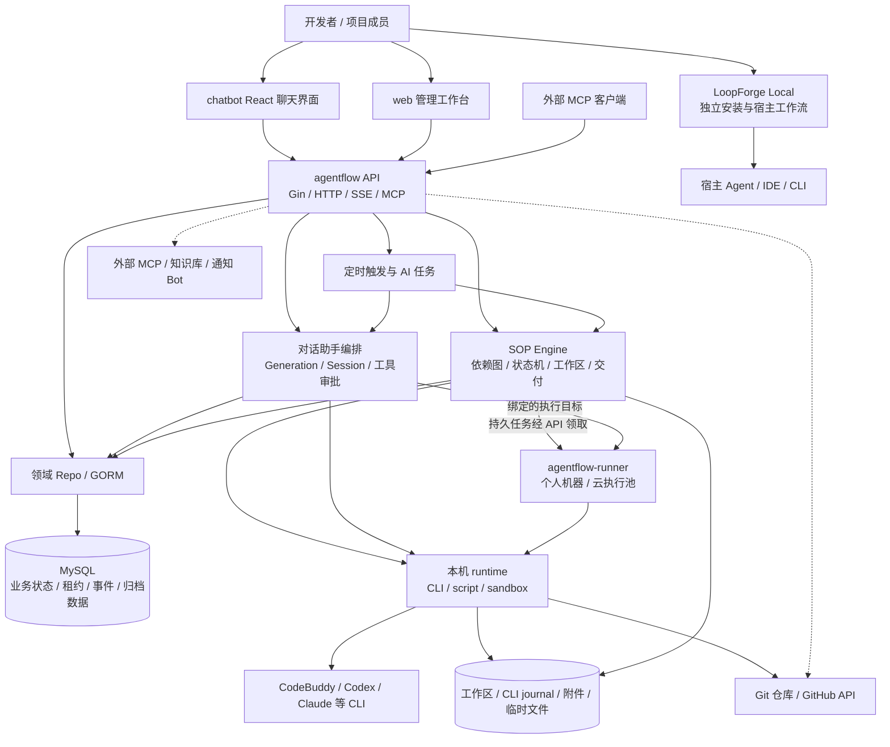
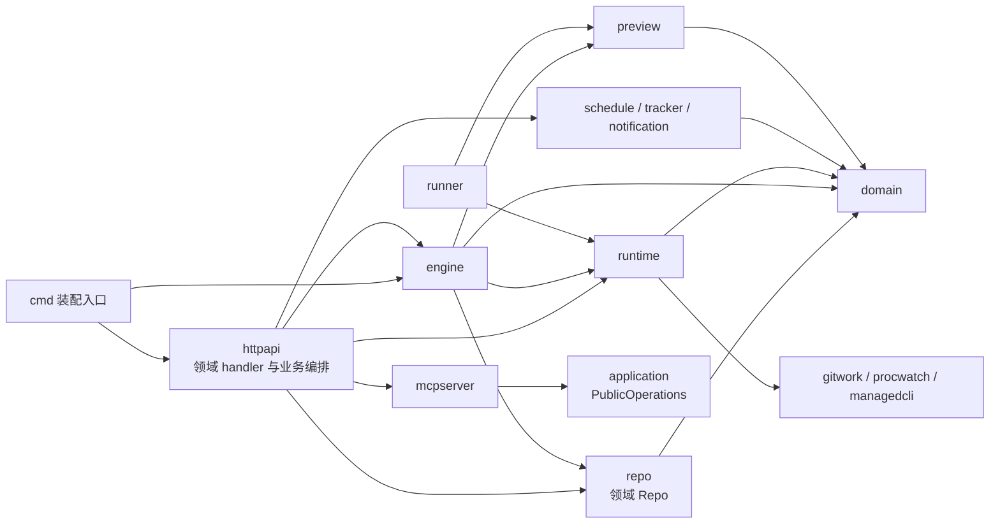
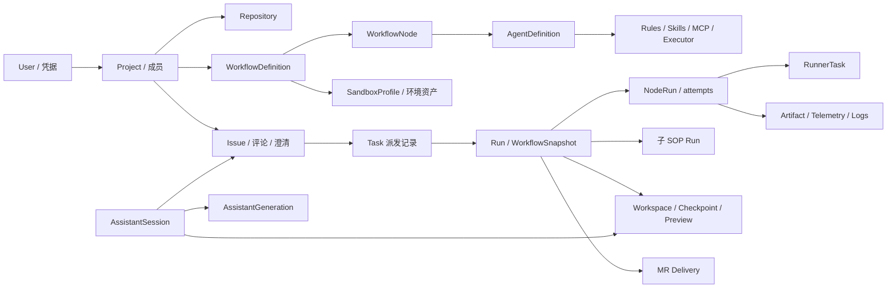
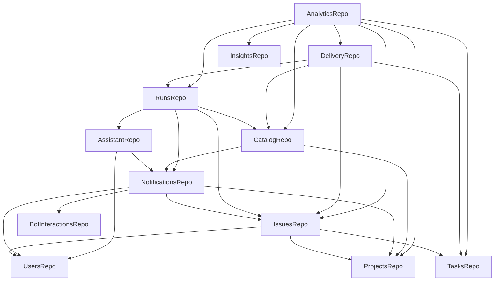
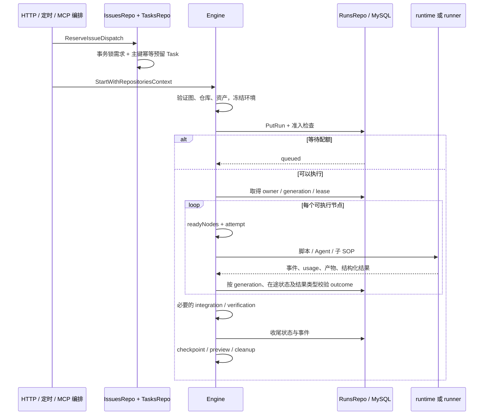
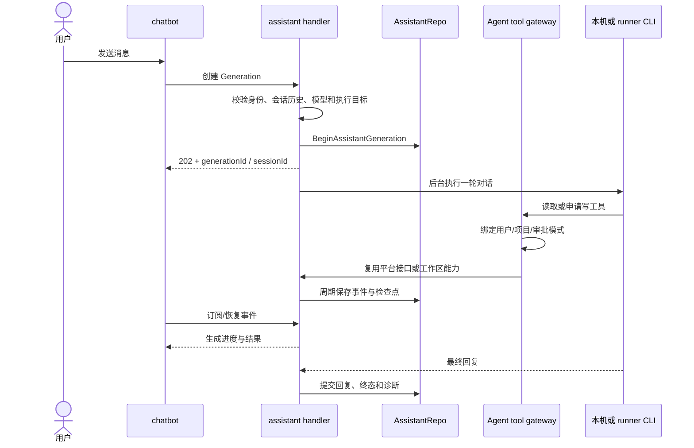
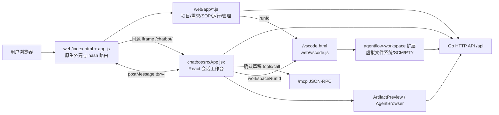
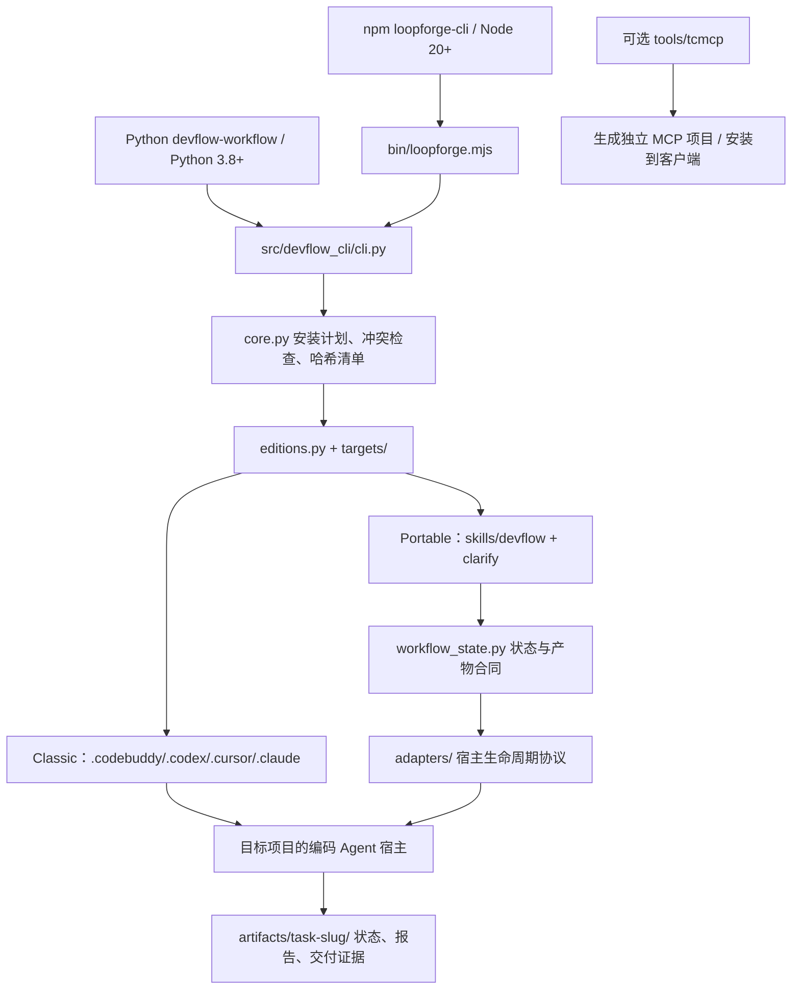

# LoopForge 项目架构与开发导航

> 分析日期：2026-11-17。代码基线：`7cc5911`。本文面向接手开发、评审和排障的工程师。
> 依据为当前仓库的入口、类型、调用关系、配置、测试与 CI；已有文档用于交叉核对。设计收益与代价属于基于实现的分析，不等同于作者原始决策记录。本文没有通过部署或真实模型调用验证运行环境。

## 交互架构与数据流图

- [系统架构与模块依赖](.archify/architecture-loopforge-20261117-205856/loopforge-architecture.html)：模块级全景，包含执行边界、关键功能、持久化和依赖组件。
- [数据流转与产物去向](.archify/dataflow-loopforge-20261117-205856/loopforge-dataflow.html)：需求、对话、任务执行、运行证据、交付消费及独立 Local 流程。

两张图由 Archify 生成，可查看源码引用、切换明暗主题及导出。图的源码证据固定在 `7cc59111848653ee45c08525b511aca6c01809be`；本文和 `.archify/` 是本次新增的未提交分析产物，未作为该提交的实现证据。

## 阅读导航

- [1. 先建立整体认识](#1-先建立整体认识)
- [2. 系统架构与部署边界](#2-系统架构与部署边界)
- [3. 领域模型与数据归属](#3-领域模型与数据归属)
- [4. 平台后端与执行引擎](#4-平台后端与执行引擎)
- [5. 对话助手与工作区](#5-对话助手与工作区)
- [6. 前端架构](#6-前端架构)
- [7. LoopForge Local](#7-loopforge-local)
- [8. 外部集成与支撑模块](#8-外部集成与支撑模块)
- [9. 工程思想与技术权衡](#9-工程思想与技术权衡)
- [10. 接到任务时去哪里开发](#10-接到任务时去哪里开发)
- [11. 开发环境与验证策略](#11-开发环境与验证策略)
- [12. 阅读路线与维护方式](#12-阅读路线与维护方式)

## 1. 先建立整体认识

LoopForge 把“需求 → 澄清 → SOP 执行 → 人工决策 → 代码/文档产物 → 交付与复盘”组织成可追踪的协作过程。仓库同时包含一个自托管平台和一个可独立安装的本地产品。

接到任务先判断它属于哪条链路：

| 链路 | 主要入口 | 核心状态 | 主要执行位置 | 典型任务 |
| --- | --- | --- | --- | --- |
| 平台 SOP | `internal/httpapi/issues.go`、`runs.go`、`dispatch.go` | Task、Run、NodeRun、Run lease | Go worker 或个人/池化 runner | 改节点调度、门禁、重试、交付 |
| 平台对话 | `internal/httpapi/assistant_generation.go`、`assistant.go` | AssistantSession、AssistantGeneration、工作区使用租约 | 平台进程或已绑定 runner | 改 Main Bot、流式消息、工具审批、会话工作台 |
| LoopForge Local | `local/bin/loopforge.mjs`、`local/src/devflow_cli/cli.py` | 本地 workflow 状态、产物与宿主执行记录 | 用户选择的宿主 Agent/CLI | 改本地工作流、安装、Portable 技能、宿主适配 |

对话可以创建需求、启动 SOP，也可以打开或借用工作区；这不意味着对话的一轮生成就是 SOP 的一个节点。Local 也不是平台 worker 内部调用的 Python 执行后端。

### 1.1 名词对照

| 名词 | 在本项目中的含义 | 不应混淆 |
| --- | --- | --- |
| Project | 项目配置、成员、代码仓和默认 SOP 的组织单位 | 不等于严格隔离的租户 |
| Issue | 可被澄清、绑定仓库、执行多个 SOP 的需求/工作项 | 不等于每次运行 |
| Workflow / SOP | 节点、依赖、角色、脚本和门禁组成的流程定义 | 定义可修改；运行使用自己的快照 |
| Agent definition | 平台中的角色配置，组合 prompt、规则、技能、MCP、执行器 | 不等于已启动的模型进程 |
| Task | 需求派发产生的持久记录，参与幂等与 Run 关联 | 不等于 RunnerTask，也不等于定时任务 |
| Run | 一次 SOP 执行，或由对话工作区机制维护的 workspace 模式记录 | 先看 run mode 再选择控制动作 |
| RunnerTask | 平台交给执行机器的一次可领取执行单元 | 不是业务 Task 的别名 |
| Worker | `agentflow -role worker`，拥有平台数据库与引擎能力 | Runner 是独立机器代理，不直接访问数据库 |
| Executor | 如何调用脚本或 Agent CLI | 不决定文件系统隔离方式 |
| Sandbox | 工作区及进程的隔离配置与生命周期 | Docker 镜像只是其中一种实现材料 |
| Gate | 节点结果或人工审批的结构化控制契约 | 不等于聊天工具审批或真实测试结论 |
| Artifact / Preview / Checkpoint | 不可变执行产物 / 可访问的展示物 / 可恢复工作区快照 | 三者用途、保留期与回收时机不同 |
| Room / Space | 聊天协作容器 / 叠加需求、线程、产物与泳道的协作空间 | 不等于个人 AssistantSession |

### 1.2 仓库导航

| 目录 | 职责 | 开发时的归属判断 |
| --- | --- | --- |
| [cmd/](cmd/) | 五类 Go 可执行入口 | 改启动、进程角色、命令参数 |
| [internal/domain/](internal/domain/) | 领域类型、状态、验证和纯规则 | 改跨层共享的业务含义 |
| [internal/httpapi/](internal/httpapi/) | 路由、身份/权限、业务编排、助手、SSE、工作台接口 | 改用户动作和请求契约 |
| [internal/repo/](internal/repo/) | 领域持久化、事务、幂等、租约与查询 | 改数据库行为和一致性 |
| [internal/engine/](internal/engine/) | SOP 图调度、执行控制、工作区和交付协调 | 改运行状态机 |
| [internal/runtime/](internal/runtime/) | CLI、脚本、沙箱、进程、浏览器等本机执行机制 | 改“这台机器如何执行” |
| [internal/runner/](internal/runner/) | 独立执行机器的领取、续租、上报、工作区协议 | 改远程机器行为 |
| [chatbot/](chatbot/) | 原生聊天 React 前端源码 | 改消息与对话交互 |
| [web/](web/) | 嵌入式管理工作台、页面模块、编辑器与静态资源 | 改资产、项目、流程、运行等管理 UI |
| [local/](local/) | 独立 Local CLI、工作流、宿主集成和测试 | 遵循其自己的 `AGENTS.md` |
| [migrations/](migrations/) | 人工可审阅 SQL 与显式公共 seed | 改数据/历史 schema/模板安装 |
| [scripts/](scripts/)、[deploy/](deploy/) | 安装、构建、开发、部署与机器绑定 | 改交付链路 |
| [e2e/](e2e/)、[webtest/](webtest/) | 平台接口/浏览器验收、管理端逻辑测试 | 证明跨模块行为 |
| [docs/](docs/)、[skills/](skills/) | 契约说明、操作文档、外部用量上报技能 | 对外集成与维护说明 |
| [third_party/](third_party/) | 第三方归属与许可材料 | 引入上游内容时一起检查 |

代码仍使用 Go module `agentflow`、`AGENTFLOW_` 环境变量及部分历史 JSON 字段名。这是兼容与减少上游同步冲突的选择；新增功能不能只按产品展示名推测代码符号。

## 2. 系统架构与部署边界

### 2.1 总体架构图

实线表示主要请求或运行依赖；虚线表示可选外部能力。图中的 API 与 worker 可在一个 `all` 进程内，也可分开部署。



**部署上的关键区别：** worker 依赖平台数据库；runner 通过 HTTP 长轮询、租约与 WebSocket 控制连接接入平台。不能用“多启动几台 runner”替代 API/worker 配置，也不能让 runner 依赖平台的数据库访问对象。

### 2.2 Go 可执行程序与启动过程

| 入口 | 作用 | 关键依赖 |
| --- | --- | --- |
| [cmd/agentflow/main.go](cmd/agentflow/main.go) | API、worker、all 三种角色，进程生命周期与后台服务装配 | repo、engine、runtime、httpapi、tracker、notification、config |
| [cmd/agentflow-runner/](cmd/agentflow-runner/) | 个人/池化执行机器，连接平台并执行领取的任务 | runner、runtime、managedcli |
| [cmd/agentflow-mcp/](cmd/agentflow-mcp/) | stdio MCP 到平台 HTTP 的桥接 | mcpserver.RemoteInvoker |
| [cmd/agentflow-gate-mcp/](cmd/agentflow-gate-mcp/) | SOP 内结构化提交门禁结果 | gatemcp；不是平台全量能力入口 |
| [cmd/loopforge-account/](cmd/loopforge-account/) | 显式创建/重置平台账户和授予管理权 | repo；独立于正常服务启动 |

`main` 的正常启动顺序是：加载 `.env` 与参数 → 校验 session secret → 确定角色和工作区根 → `repo.Open` → 创建 runtime Manager 与 Engine → 配置实例身份、租约、执行池和端点 → 装配控制通道/HTTP/后台服务 → 启动维护与领取循环 → 对外服务。

控制端点及 runner transport 必须先装配，再允许引擎领取工作。源码专门约束了这一顺序，避免启动时节点运行在不完整的依赖环境里。

| 角色 | HTTP 形态 | 执行 SOP | 其他说明 |
| --- | --- | --- | --- |
| `all` | 完整 API 与静态资源 | 默认执行，可由配置关闭 | 最直接的单机开发方式 |
| `api` | 完整 API、助手及后台集成 | 不启动本地 Run claim 执行 | 这不等于整个进程完全不启动 CLI；助手等路径仍有执行职责 |
| `worker` | worker 控制端点 | 执行并维护 lease | 与 API 共享 MySQL，配置控制地址和 token |

进程收到退出信号后先停止领取，再处理在途工作，最后关闭服务。`cmd/agentflow/handover.go` 实现 API/all 的监听 socket 交接；接班进程的恢复操作受 predecessor recovery gate 约束。修改启动、取消、后台 goroutine 时，要同时考虑普通退出和进程交接。

### 2.3 真实的代码依赖

这套代码以领域拆 Repo/handler，但并非每个请求都经过统一的 application service 层。`internal/application/operations.go` 主要是公共能力清单；许多业务流程直接在 `internal/httpapi/` 编排。



这是主干依赖图，省略了辅助包的部分边。`domain` 不导入其他 `internal` 包；`runner` 不导入 `repo`/`engine`；`preview` 通过接口回调 host，避免反向导入 engine。另一方面，`repo` 内已有对 `gitwork`、`gongfeng`、`observability` 的依赖，因此不应把现状描述成完全无外部行为的纯数据层。

### 2.4 HTTP、MCP 与内部控制三种接口

1. 用户接口在 [internal/httpapi/server.go](internal/httpapi/server.go) 注册；HTTP 方法、路由、鉴权和域级授权以此及对应 handler 为准。
2. 公共 MCP 从 [PublicOperations](internal/application/operations.go) 构造工具清单；[LocalInvoker](internal/mcpserver/server.go) 生成请求重新进入同一 HTTP handler，携带调用者身份；stdio 入口使用 RemoteInvoker 转发到平台。
3. runner、lease、工作区 relay、私有 Agent tool gateway 属于内部/机器协议，不因存在 HTTP 路由就自动成为公共 MCP 工具。

因此“新增接口”与“让 Agent 能调用这个接口”是两个交付步骤。通常需要一起检查路由、`PublicOperations`、[docs/api/openapi.yaml](docs/api/openapi.yaml)、[internal/mcpserver/schema.go](internal/mcpserver/schema.go)、助手工具选择/审批逻辑和契约测试。当前公共清单是 HTTP 能力的子集，不能假定两者完全一一对应。

## 3. 领域模型与数据归属

### 3.1 领域对象与关系

领域协议在 [internal/domain/](internal/domain/)，物理持久模型在 [internal/repo/models.go](internal/repo/models.go) 等文件。前者描述业务语义和 JSON 合同，后者组织数据库行与查询列。不要直接把浏览器提交的 domain 对象当成可信 ORM 行保存。

下面是逻辑关系图，表示业务关联，不表示数据库逐项建立了外键或强制级联删除。一个 Issue 可执行多个 SOP，Task/Run 还存在子 SOP、重跑和历史兼容关系，不能强行简化为全局一对一。



多仓库运行使用 `RepositoryContexts()` 遍历全部仓库；旧单数 `Repository` 字段仅镜像首项。各代码仓通常位于共享工作区的一层子目录，SOP 文档产物位于 Run 根目录。新增多仓能力时，不能只改旧字段而漏掉其他仓库。

### 3.2 持久化组织与一致性

当前持久层组合 JSON payload、可查询/排序/锁定的投影列，以及事件、日志、遥测、产物等子资源表。这样可以持续演进定义结构，也避免每次追加日志都重写整个巨大 Run。代价是新增过滤/统计字段时必须检查 JSON 与投影列的一致性。

生产数据源为 MySQL，没有生产内存 fallback；`OpenTest` 使用隔离测试数据和 SQLite 等测试机制。SQLite 用例不能证明 MySQL 的行锁、隔离级别、JSON 查询、生成列或数据库时钟行为。

[repo.Open](internal/repo/repo.go) 配合 [automigrate.go](internal/repo/automigrate.go) 只增加缺失表、列、索引；这是受约束的增量 migrator，不应理解为启动时对现有表做任意 schema 重写。业务数据迁移、基线与 seed 属于 `migrations/` 的显式 SQL；`OpenTest` 的默认测试数据禁止进入生产调用链。

### 3.3 全部领域 Repo 的归属

[Store](internal/repo/repo.go) 当前组合 **21 个**领域 Repo。根 AGENTS 表列出核心约束，下面补足代码中已存在的其他领域；不能因为规则表没列到某个 Repo，就把其方法放到相邻领域。

| Repo | 当前职责与关键文件 |
|---|---|
| CatalogRepo | 可复用定义：agent/rule/skill/MCP/executor/dockerfile/environment/sandbox/workflow/repository、同步配置、schedule jobs、generic templates、definition revisions。`catalog.go`、`generic_store.go`、`skill_files.go`、`mcp_files.go`、`schedule_job_results.go`、`schedule_job_executions.go` 等（revision 与 schedule job CRUD 同在 catalog.go） |
| ProjectsRepo | 项目/成员/归属历史；`projects.go`、`project_business_domain.go` |
| BusinessDomainsRepo | 业务域定义与乐观并发更新；`business_domains.go` |
| IssuesRepo | 需求、评论、澄清相关生命周期、派发预留入口；`issues.go`、`issues_delete.go`、`requirement.go` |
| TasksRepo | 跨实例任务派发幂等记录；`tasks.go` |
| UsersRepo | 用户、provider/git/SSH 凭据、平台管理员、平台共享 key；`users.go`、`local_accounts.go`、`platform_admin.go`、`git_ssh_credentials.go`、`gongfeng_credential.go` |
| TokensRepo | API token 哈希与生命周期；`tokens.go` |
| AssistantRepo | 会话、共享任务、定时 prompt、生成队列、工具审批、偏好、诊断、附件引用、执行目标；`assistant*.go` |
| RunsRepo | Run 与 node/event/log/telemetry/artifact、SOP 指标/eval、执行租约、workspace/checkpoint/恢复/编辑；`runs.go`、`run_admission.go`、`run_evals.go`、`workspace_checkpoints*.go`、`workspace_restore.go`、`run_workspace_edit.go` |
| RunnersRepo | runner 注册/心跳/默认选择、任务租约/事件；`runners.go` |
| DeliveryRepo | MR 交付聚合状态及锁；`delivery*.go` |
| AnalyticsRepo | 运营分析聚合；`analytics*.go`。读视图跨多个域，不能复制为写业务入口 |
| InsightsRepo | 外部 workflow 使用来源与幂等执行上报；`insights.go` |
| PreviewsRepo | run 预览元数据/归档相关持久化；`previews.go` |
| EngineInstancesRepo | worker/API 实例注册心跳与控制地址；`engine_instances.go` |
| RoomsRepo | 项目房间、消息、thread/dispatch 时间线与附件引用查询；`rooms.go` |
| SpacesRepo | 需求空间、成员、artifact 版本、thread；`spaces.go` |
| KnowledgeRepo | 知识中心设置、提交队列；`knowledge.go` |
| FeedbackRepo | 页面反馈和图片（独立于项目/Issue）；`page_feedback.go` |
| NotificationsRepo | 机器人配置、通知发件队列/claim/重试；`notifications.go`、`notification_*.go` |
| BotInteractionsRepo | 机器人连接租约、互动队列、会话/消息幂等；`bot_interactions.go` 等 |

### 3.4 Repo 的显式依赖图



箭头为调用依赖，所有 Repo 还共享唯一 `deps{DB *gorm.DB}`。这只是显式指针关系，不代表所有 SQL 只读取自己的一张表；部分聚合直接查询跨表。新增领域方法归领域 Repo，不能继续放 Store；新跨域引用在 newStore 装配，避免循环。

### 3.5 Catalog 的几个特殊合同

- Catalog 管理的是定义和配置；运行事实属于 RunsRepo，用户凭据属于 UsersRepo，PR/MR 聚合事实属于 DeliveryRepo。
- `Workflows()` 先按 UpdatedAt 返回物理 workflow，再把 generic 模板追加到尾部；模板不混入排序。`Workflow(id)` 对同 ID 优先解析 generic 模板；写入/删除通过 storedWorkflow 只处理物理行。
- 通用模板的采用/复制不等于持续订阅模板内容；修改 seed 不会自动替换用户已经编辑或复制的项目资产。升级 SQL 应使用适用条件保护既有修改。
- 修订与 schedule job CRUD 当前就在 `repo/catalog.go` 等实际文件中，不存在一套统一的 `repo/revisions.go`/`schedule_jobs.go` 供所有操作使用。
- 内置可选 executor catalog 由代码中的 `BuiltInExecutors` 定义；历史 executor 表用于兼容，不意味着可以通过保存任意 binary/args 添加任意执行器。

## 4. 平台后端与执行引擎

### 4.1 主模块分工

| 模块 | 对外承担的职责 | 核心源码 |
| --- | --- | --- |
| Engine | 启动/调度/控制 Run，协调角色、工作区、交付和恢复 | `run_start.go`、`node_execute.go`、`node_outcome.go`、`run_ops.go`、`run_state.go` |
| 图与并行调度 | DAG 校验、ready 判断、并行分支、依赖重置 | `workflow_graph.go`、`parallel_exec.go`、domain/workflow.go |
| 运行环境与资产 | 共享 checkout、沙箱快照、角色和输入物化 | `run_environment.go`、`repository_workspace.go`、`assets.go` |
| 远端派发 | 创建 durable runner task、等待事件、下发控制、读取能力 | `runner_dispatch.go`、domain/runner.go、repo/runners.go |
| runtime | CLI/provider、脚本、sandbox、浏览器、终端、进程和文件合同 | `runtime.go`、`provider.go`、`runner.go`、`sandbox_manager.go` |
| runner daemon | 与平台注册/心跳/claim，执行并回传结果 | `daemon.go`、`client.go`、`control.go`、`exec.go` |
| workspace 生命周期 | 保存/恢复/使用/空闲回收、子工作区 owner | engine/repo/runtime 的 `workspace_*.go`、runner/workspace.go |

表中只写文件名的 engine/runtime/runner 行，均相对于对应 `internal/<模块>/`；精确的任务导航见第 10 节。

### 4.2 从需求派发到节点结束



具体过程：

1. `httpapi/dispatch.go` 选择责任人、SOP、绑定仓库和工作分支，组装输入与执行上下文。`IssuesRepo.ReserveIssueDispatch` 在事务中预留 Task，阻止同一派发身份跨实例重复启动；Issue 删除与派发也不能同时成功。
2. `StartWithRepositoriesContext`/`startWorkflowDefinition` 获取流程，规范化运行专用字段，补沙箱默认值及 preview build 节点，验证 DAG/资产，确定责任人和执行目标，并冻结环境。
3. 初始化 pending NodeRun 与 Run。API 角色写入未归属运行，由 worker 接管；有执行权的实例按租约启动。准入可以将 Run 改成 queued，queued 不直接执行。
4. `execute` 续租并观察 durable cancel/pause，选择前驱全部成功的 ready 节点。ready 分支分别执行，某分支结束即可唤醒下游，不需要等同一批所有分支都完成。
5. 节点类型为 `agent`、`script`、`approval`、`sop`；历史 command 兼容为脚本。人工节点等待决定，子 SOP 启动/跟踪 child Run，Agent 节点解析角色、资产和只读上游输入，交给本机 runtime 或远端 runner。
6. runtime 完成 MCP provision、调用目录物化、provider Prepare、Sandbox.Exec、流式协议适配。进程 exit 0 只是进程事实，产物、verification 与结构化 gate 决定业务结果。
7. outcome 写入通过 `shouldCommitNodeOutcome` 检查 generation、节点仍在途及结果类型：失败要求 attempt 相等；成功有意允许期间 attempt 已递增。不能统一改成简单的 attempt 相等判断。需要返工时重置相应后继，并取消被替代调用；最终还可能做 scheduled integration、归档、预览、通知与工作区清理。

### 4.3 运行与节点状态

| 对象 | 当前常用状态 | 读状态时要同时看 |
| --- | --- | --- |
| Run | `queued/running/waiting/succeeded/failed/cancelled` | Kind、PauseRequested、节点状态、waiting reason |
| NodeRun | `pending/running/pending_input/waiting_approval/succeeded/failed/cancelled` | attempt、rework、门禁、输入请求、ChildRunID |
| Task | `queued/dispatched/running/completed/failed/cancelled` | 关联 Issue、SOP、Run |
| RunnerTask | `queued/leased/running/success/failed/canceled` | lease owner、desired_state、事件序号 |
| ScheduleJob.LastStatus | `running/success/failed/waiting` 等 | execution record、traceId、session/run 关联 |

`Run.waiting` 既可能是等审批，也可能是暂停或空闲 workspace；`pending_input` 仍表示节点调用正在等待输入。RunnerTask 使用 `success/canceled`，Run 使用 `succeeded/cancelled`，前端和新增适配器不得擅自统一字符串。`/api/runs/{id}/control` 提供可用动作和等待原因，界面应使用其控制语义。

### 4.4 租约、并发与幂等

| 机制 | 权威事实及主要实现 | 防止什么问题 |
| --- | --- | --- |
| 派发预留 | IssuesRepo/TasksRepo，事务与 task 主键 insertIgnore | 重复触发同一派发、多实例同时派发、删除与派发竞争 |
| Run 执行租约 | `owner_instance_id + execution_generation + lease_until`，repo/runs.go | 多实例接管后的旧执行者继续写；过期 owner 覆盖新结果 |
| 人工决定的并发检查 | revision、NodeExpectation、PutRunAtRevision | 用户对旧节点/旧审批轮次作决定 |
| durable cancel/pause | 独立控制列，RequestRunControl/ClearRunControl | worker 用旧 Run 快照吞掉 API 已发出的取消 |
| RunnerTask lease | 数据库事务 claim 与状态/owner 条件更新 | 两台机器执行同一次领取；非 owner 完成任务 |
| 工作区 use/save/restore token | repo/workspace_checkpoints*.go 等，独立 token 与行锁 | 后台保存、前台使用、恢复和维护相互覆盖 |

Run 默认租约 TTL 为 30 秒，执行按 TTL/3 续租；切换 owner/重新进入相应执行世代会增加 generation。把 generation 带到 outcome 提交是 fencing：只让当前世代更新持久运行事实，不能据此声称 Git push、外部 MCP 或通知恰好执行一次。

runner 的 WebSocket 用于及时控制与工作区请求；desired_state 和任务状态保存在数据库，续租响应也能传递取消意图，因此断开 WebSocket 不等于任务或取消丢失。新 runner 能力还需要 domain capability/version gate，旧版本应明确拒绝，不能静默丢字段。

进程内还存在 run 读改写、节点尝试、同角色控制目录、首节点池绑定和共享环境准备等锁。它们用于同进程竞争；跨实例正确性仍需数据库条件更新与 token。

### 4.5 准入配额与机器并行数

[repo/run_admission.go](internal/repo/run_admission.go) 区分项目与个人 runner 准入桶：平台顶层 SOP 的项目上限当前是 10，个人 runner 使用 RunLimit（0 不限），子 SOP 共享顶层 slot，workspace 不占普通 SOP 配额。事务保持桶锁与 Run 行锁的既定顺序。

**已准入名额不等于正在执行的 goroutine 数。** 当前 occupied 查询排除 succeeded、queued、未启动记录；failed/cancelled 等已准入运行仍可能计入。改变这个规则前必须读对应 admission 测试，不能只把查询改成 `status=running`。queued 的晋升应保持桶内顺序，避免新请求插队。

runtime Manager 的 slots 和 runner daemon 的 MaxConcurrency 则限制单台执行机的实际并行命令；它们与平台准入是两层限制。

### 4.6 快照、重跑、恢复的准确含义

| 场景 | 当前行为 | 不能做的假设 |
| --- | --- | --- |
| 首次启动 | WorkflowSnapshot 固定图，Run.Repository/Repositories 固定仓库上下文，SandboxSnapshot 固定已解析 profile/Dockerfile/environment | 不能说所有 role/rule/skill/MCP 永久冻结 |
| 解析角色资产 | `workflowAgent`/`resolveAssets` 读取当前角色与规则/技能/MCP，并过滤可见性 | Catalog 修改可能影响后续执行 |
| retry/replay | 拒绝仍 running/active 的 Run；指定节点 replay 要求全部上游成功；重置目标与后继，保存旧尝试产物；恢复被全局取消的并行 sibling；overlay 当前节点绑定/失败策略等 | 不能把 retry 当成只重启一个进程 |
| RefreshRunSOP | 对允许的停止状态换用当前图，保留同 ID 节点结果，新节点 pending；保持原 SandboxSnapshot | 不能顺便在旧 checkout 下切换执行环境 |
| ResumePaused | 从用户暂停位置继续，先处理暂停子 SOP | 不能借 resume 自动批准普通 approval gate |
| 崩溃接管 | claim loop 先晋升 queued，再接管无有效 owner 的 running；中断 active 节点回 pending，可用 session 信息续接 | 普通等待人工的 waiting 不应自动重跑 |
| 工作区恢复 | 根据 host/root owner、checkpoint、runner facts、restore 状态协调 | 未 push 的改动不因 DB 还在就自动出现在其他机器 |

子 SOP 最大嵌套当前为 6，并沿父链检查循环。child 有独立记录、执行世代及环境处理，通过 WorkspaceRunID 指向共享 checkout owner；父节点保存 ChildRunID，重启后跟踪原 child，成功后把子产物映射成父步骤输出。历史 group 协作记录有兼容读路径，不宜当作当前新增执行模式的样板。

### 4.7 Provider、Sandbox 与工作区合同

`runtime.Provider` 隐藏不同 CLI 的资产物化、Prepare、协议、沙箱要求、观测与 hooks；`Sandbox` 暴露 ID、Workspace、Exec、Close。两者是正交变化点：增加 CLI 先改 provider，增加系统隔离先改 driver，避免引入 CLI × driver 的大量组合实现。

| 层 | 合同与取舍 |
| --- | --- |
| CommandSpec | 闭合的启动合同；调用者申请已知 credential binding/特性，不直接注入任意环境字典 |
| RunCredentials | 内存 handle，不写入通用 Run JSON/run-context；用户凭据本来会在 UsersRepo 持久化，某些远端调用也会携带任务级凭据，完成后 scrub |
| Provider-neutral events | 各 CLI stdout/stream/hook 归一成 telemetry、usage、工具和可见输出 |
| Sandbox driver | local/docker/seatbelt/bwrap；native 按 OS 解析，macOS seatbelt、Linux bwrap；local 仅受控环境/私有 HOME，不等于 OS 隔离 |
| 共享环境 | 按 Run 复用工作区，准备阶段受锁保护，Docker execGate 避免重建容器伤及并行节点 |
| 不可变输入 | 上游产物按 attempt 保存，按来源和产物标识取最新登记版本，只读放入 `.agentflow/inputs/` 并在提示里给路径/hash；版本选择本身不筛选成功状态，节点调度仍要求前驱成功 |
| 文件编辑 | expected hash 与服务端可写性协调 IDE/Agent 并发；共享 checkout 才是当前代码事实 |
| 生命周期 | 文件锁、数据库租约、checkpoint、preview hold 协同；重启后不能只信进程内 map 判断容器/目录是否存在 |

内置可选 CLI 当前包括 CodeBuddy、Codex、Claude Code、OpenCode、Cursor、Antigravity、Kimi、Pi、DeepSeek Harness、ZCode。具体版本与支持能力随代码/发布变化；自定义 CLI 需要完成 provider、认证、协议和远端能力适配，不能靠历史 executor 表任意保存 binary 来扩展。

## 5. 对话助手与工作区

### 5.1 Session、Generation、CLI journal 分别负责什么

[AssistantSession](internal/domain/assistant.go) 保存权威会话内容、项目/需求/运行关联、模型、执行目标与历史修订；[AssistantGeneration](internal/domain/assistant_generation.go) 表示一轮后台生成，保存事件、回复、取消/转向状态与诊断。CLI 原生 transcript/checkpoint 是本地续聊缓存，不能反过来覆盖平台权威会话。

主要链路位于 [assistant_generation.go](internal/httpapi/assistant_generation.go)：



创建生成时使用脱离浏览器请求取消的 context。关闭页面不会自然等同于停止模型；取消通过持久记录被后台执行器观察。工作区使用租约另行续期，避免生成记录写入阻塞时同时失去工作区保护。修改生成流程时，应同时检查 `assistant_generation_recorder.go`、`assistant_live.go`、`assistant_resume_recovery.go`、`assistant_diagnostics.go` 及 repo 中的 generation 实现。

### 5.2 工具网关与审批

[agent_tool_session.go](internal/httpapi/agent_tool_session.go) 为每轮对话绑定随机 token、UserID、ProjectID、模式、工作区、允许的 MCP、取消函数与终态结果。主服务创建私有 loopback Agent tool gateway；工具不是靠 prompt 文本自行选择身份。

[assistant_write.go](internal/httpapi/assistant_write.go) 中的策略把审批模式转换为具体写权限：确认模式阻止直接写并要求草稿，自动模式允许写，辅助模式对具体写操作增加独立模型审核。公共操作的 `ReadOnly` 标记会影响写识别，因此它是行为契约的一部分。

同时存在原生工具与外部写识别路径，例如 [assistant_native_external.go](internal/httpapi/assistant_native_external.go)。其中对 `git push`、HTTP 写请求、发布等命令的匹配是防误操作措施，源码明确说明它不构成可靠的网络安全隔离。开发者不能把该匹配器当作沙箱权限系统，也不能假定每种 CLI/执行模式允许相同的原生工具。

### 5.3 模型与执行目标

模型/CLI 选择分布在 `assistant_engines.go`、`assistant_provider.go`、`assistant_engine_*.go`、`executor_models.go` 以及 runtime 各 provider adapter。角色与 Main Bot 使用相关的用户凭据机制，但启动参数、流式解析、模型发现与原生工具约束并不完全相同。

会话执行目标由 [assistant_execution.go](internal/httpapi/assistant_execution.go) 校验，已锁定的目标不能随一次请求任意切换。切换 CLI 也不能直接继续另一个 CLI 的原生日志；`assistant_engines.go` 会跟踪 engine/session/history revision，以平台消息重建可用的上下文。

新增一种 CLI 时，至少核对：domain 凭据与公开脱敏结构 → runtime 命令/认证/事件解析 → managedcli 安装维护（若托管）→ runner inventory → assistant provider/model/effort → 前端执行器选择与凭据表单 → 协议测试。只在下拉框加一个选项无法完成适配。

### 5.4 对话工作区、SOP 工作区与协作空间

| 能力 | 主要源码 | 依赖与修改注意点 |
| --- | --- | --- |
| 打开对话独立工作区 | `assistant_workspace_open.go`、`assistant_workspace_turn.go` | 通过 engine/runtime 准备执行环境，关联 session 和 workspace 模式 Run |
| 借用需求的 SOP 工作区 | `conversation_sop.go`、`assistant_workspace_sop_notice.go` | 校验绑定关系和读写条件；不要与正在执行的 SOP 抢写 |
| 工作区文件、diff、提交与终端 | `run_workspace.go`、`run_workspace_edit.go`、`assistant_workspace_mr.go` | 本机与 runner 两条 transport 都要考虑；涉及 lease、权限、分支身份 |
| 工作台上下文与附件 | `assistant_workbench.go`、`assistant_conversation_attachments.go`、`assistant_attachment_sweep.go` | 所有权、引用、存储和清理时机必须一致 |
| Room/Space 协作 | `rooms.go`、`spaces.go`、`space_ai.go`、`space_lanes.go`、`space_artifacts.go` | 复用项目成员/需求/Run/会话；有自己的权限和对话容器 |
| 需求澄清 | `stream.go`、`clarify_jobs.go`、`clarify_session.go`、`clarify_mcp.go` | 独立 clarify job 与工具终态契约，不能直接套用普通聊天逻辑 |

Room/Space handler 在 `server.go` 的装配点创建，并不是每个都直接列成 `Server` 的字段。新增域应遵循根 [AGENTS.md](AGENTS.md) 的专属 handler 与显式注入规则，不按字段列表的表面形态复制历史实现。

## 6. 前端架构

### 6.1 前端不是一个单一 SPA，而是同源的两套渲染系统

当前产品入口是 `web/index.html`，原生 JavaScript 外壳负责全局图标栏、设置导航、项目切换、登录引导、管理页面和 hash 路由；在工作台区域通过 `#chatNextFrame` 加载 `/chatbot/`，后者是 React 会话应用。两者由同一个 Go HTTP 服务提供资源和认证，不是两个独立部署的前后端系统。



**事实与取舍**：原生页面无需统一迁移即可保留管理能力，React 工作台可以单独演进；代价是两套状态、两套控件实现、iframe 尺寸与生命周期，以及跨窗口消息同步。这里不是采用 React Router/Redux 的全站 React 架构。`chatbot/src/useChat.js` 用 React hooks 管理会话；`web/app.js` 暴露全局 `state`。不要给原生页面新增 React 依赖，或让两个区域各自猜测对方的项目上下文。

### 6.2 资源、启动与构建链路

| 阶段 | 源码入口 | 实际行为 |
| --- | --- | --- |
| 原生页面加载 | `web/index.html` | 加载主题/i18n，再按固定顺序加载 `/app.js` 与 `/app/*.js`；`app/start.js` 最后调用 `boot()` |
| 外壳启动 | `web/app.js:boot()` | 初始化空 `state.data` → 认证 code exchange 或 `/api/auth/current` → 必要时本机验收登录/登录页 → `/api/bootstrap` → 恢复项目、SOP、页面 → `renderAll()` / `switchView()` |
| React 启动 | `chatbot/src/main.jsx` | `createRoot` 挂载 `<App />`，用 error boundary 提供重新加载；同时导入部分共享原生控件资源 |
| React 独立开发 | `chatbot/vite.config.js` | Vite 端口 18769，base `/chatbot/`；`LOOPFORGE_API` 默认 `http://127.0.0.1:8080`；代理 `/api`、`/mcp`、IDE 与扩展资源到 Go 服务 |
| React 产物 | `chatbot/package.json`、`scripts/build-chatbot.sh` | Node ≥22；脚本执行 `npm ci`，并行执行 Vitest 与 Vite build；产物写 `web/native-chat/` |
| Go 嵌入 | `web/embed.go` | `web.Files embed.FS` 嵌入原生页面、app 目录、native-chat、IDE、monaco、vendor 等；`all:native-chat` 保留 Mermaid 等下划线开头 lazy chunks |
| 静态分发 | `internal/httpapi/studio.go:studioFileServer()` | `/chatbot/` 映射 native-chat 子文件系统；外壳和 vscode HTML 注入资源内容哈希，设置缓存策略 |
| 完整发布构建 | 根 `Makefile:build` | 先 `build-chatbot`，后编译 Go 服务、MCP、Runner、gate MCP；前端资源进入二进制 |

`web/app/*.js` 是 classic scripts，共享一个全局词法作用域，虽然拆成文件，但不是 ES module 隔离。新增脚本必须同时列入 `web/index.html`，依赖要位于使用者之前，`start.js` 仍需最后。`web/app_bundle_test.go` 验证每个 app 脚本有加载、已嵌入、顺序正确。

已运行的嵌入式二进制不会因为只改 React 源码而更新页面；发布前必须重建 React 产物和 Go 二进制。`studio.go` 关于每次请求重算哈希的行为作用于注入的 `fs.FS`；不能把这条注释理解为已编译 embed.FS 会实时读取磁盘源码。

### 6.3 原生 web 模块设计与开发定位

| 领域 | 主要源码 | 职责及依赖 |
| --- | --- | --- |
| 外壳、路由、全局状态、主题、对话框 | `web/app.js`、`web/index.html`、`web/app/navigation.css` | `boot`、`switchView`、hash 路由、`api()`、toast、`afConfirm/afPrompt`；所有原生业务模块依赖这里的 state/helper |
| SOP 模板目录 | `web/app/sops.js`、`web/app/sop-catalog.css` | 项目/共享/通用模板卡片、复制/发布状态、指标与筛选 |
| 流程设计器 | `web/app/flows.js`、`flow-history.js`、`flow-viewport.js`、`flow-palette.js`、`flow-canvas.css` | DOM 节点 + SVG 边的自研画布，撤销历史、缩放平移、节点配置、保存/发布、静态预览契约；`state.workflow` 是编辑态，`workflowSaved` 用于 dirty 判断 |
| 角色定义 | `web/app/agents.js`（并与 flows 共享角色编辑入口） | Agent CLI/模型、prompt、规则技能工具、产物与门禁配置；角色是可复用定义，流程节点可覆写部分执行参数 |
| 项目与仓库接入 | `web/app/projects.js`、`project-wizard.js`、`repo_drawer.js`、`github-connect.js`、`git-ssh.js`、`git-ssh-keys.js` | 项目成员、仓库绑定、OAuth/SSH 与快速配置引导；依赖项目和用户身份 |
| 需求 | `web/app/issues.js`、`issue-model.js`、`issue-bulk-delete.js`、`issue-drawer.js`、`composer.js` | 列表/看板、详情、导入澄清、派发、批量删除；需求跳工作台通过 `openIssueInChat()` 带 @ 引用 |
| 运行记录 | `web/app/runs.js`、`run-activation.js` | 启动/重试/审批/取消、节点详情、日志遥测、子 SOP、工作区、预览、评估；SSE 优先，序号合并与轮询回退 |
| 审批 | `web/app/approvals.js` | 统一待人工处理视图，依赖 run/node 状态及权限 |
| 资产与工具 | `web/app/assets.js`、`mcp.js`、`skillhub.js`、`revisions.js` | 规则、技能文件、Dockerfile、环境脚本、沙箱、MCP、市场与修订 |
| 执行机器 | `web/app/runners.js` | Runner 注册、下载和状态展示；不是实际进程执行器 |
| 定时与同步 | `web/app/sync-schedule.js`、`shared-schedules.js`、`schedule-executions.js` | 定时 SOP / prompt、执行记录、同步配置；保持现有后端调度语义 |
| 用户与平台配置 | `web/app/workbench.js`、`assistant-settings.js`、`assistant-models.js`、`access.js` | 个人凭据/模型目录、平台管理、AI 助手偏好、接入文档与 Token UI。注意这个 app/workbench.js 与根 web/workbench.js 不同 |
| Bot | `web/app/bots.js`、`notification-editor.js` | 通知 Bot 编辑向导、消息与对话记录、权限和模型设置 |
| 统计分析 | `web/app/observability.js`、`obs-charts.js`、`dashboards.js` | 运营指标、耗时、Token、成本和图表；ECharts 本地资源按需加载 |
| 页面反馈 | `web/app/page-feedback.js` | 文本/图片、页面元素拾取、拖动与隐藏；通过 `/api/page-feedback` 写独立反馈域 |
| 国际化与主题 | `web/i18n.js`、`i18n-en.js`、`boot-theme.js`；chatbot `theme.js` | 与 React 工作台共享主题键 `agentflow.theme.v3`；JS 文案本地化与系统主题响应 |
| 共享视觉控件 | `web/app/harness-ui.css`、`hui-select.js`、`hui-date.js`、`hui-tooltip.js`、`hui-upload.js`、`harness-motion.js`、`hover-ink.*`、`sliding-tabs.*` | 原生页面唯一 `--hui-*` 令牌来源；组件增强和清理，React 部分复用 sliding-tabs 等资源 |

新增页面一般需要同时处理 `index.html` view/nav、`app.js` 视图标题/路由/权限与 `switchView`、业务脚本及样式、embed/加载测试。仅改变某一业务表单通常只需改对应 `web/app/` 文件，不应扩大到 React 会话。

### 6.4 React 会话工作台模块设计

| 模块 | 主要源码 | 职责与依赖 |
| --- | --- | --- |
| 页面组合 | `chatbot/src/App.jsx` | 会话列表、输入框、消息、侧面板、菜单和上下文组合；实例化 `useChat`，将用户操作交给状态 hook |
| 会话生命周期 | `useChat.js` | 身份/项目/模型/机器/沙箱加载，会话创建和保存、发送、停止、steer、编辑/分支、重生成、归档/删除、建议/草稿确认、SSE 与断线恢复 |
| HTTP 与协议投影 | `api.js` | `api/write/sessionPath`；assistant structured reply 解析、事件合并、流快照还原、附件与产物收集；错误保留 status |
| 消息流与活动 | `activity.js`、`ActivityTrace.jsx`、`GenerationDiagnostics.jsx`、`message-info.js` | 将事件分类为文字、思考、工具、活动、失败诊断；不能把工具执行过程当最终回答重复渲染 |
| 队列与抢占发送 | `message-queue.js`、`QueuedMessages.jsx`、`useChat.js` | 生成中普通新消息按会话入队；“立即发送”走 generation steer；待上一轮最终 transcript 加载后再启动队列下一项 |
| 模型与执行环境 | `ModelPicker.jsx`、`engines.js`、`effort.js`、`PermissionPicker.jsx`、`useExecutionMachines.js`、`ExecutionMachinePicker.jsx`、`SandboxPicker.jsx` | 显示真实模型目录、CLI/effort、confirm/assisted/auto、机器与沙箱；机器在首轮后锁定，依赖后端执行目标 |
| 会话历史与状态 | `session-history.js`、`session-sections.js`、`session-status.js`、`session-unread.js`、`SessionContextMenu.jsx`、`SidebarPreview.jsx` | 分组、归档、置顶、已读与未读、真实生成状态；与后端会话列表同步，非单靠本地忙碌布尔值 |
| 上下文输入 | `MentionPicker.jsx`、`mentions.js`、`IssueContext.jsx`、`Participants.jsx`、`element-context.js` | @ 需求/资产/成员、运行上下文、页面元素选择；组装为 references 发送 |
| 运行与子 Agent | `runs.js`、`SopRunPanel.jsx`、`RunAlerts.jsx`、`SubagentSession.jsx` | 由会话 metadata/资产/已执行草稿解析真实 run ID，经服务端读取和项目校验；workspace run 从 SOP 运行列表排除 |
| 审批和平台操作 | `NativeApprovalPanel.jsx`、`SidePanel.jsx`、`operations.js`、`platform.js` | 原生命令审批、平台写草稿/建议审阅、真实目标参数显示、防止确认前后草稿参数变化 |
| 产物 | `ArtifactPanel.jsx`、`RichContent.jsx`、`presentation.js`、`artifact-autoreveal.js` | Markdown/GFM、附件、HTML/SVG/Mermaid、PPT 导出；收集去重和侧栏自动展开 |
| 工作区 | `WorkspaceIDE.jsx`、`useWorkspaceChanges.js`、`ChangesPanel.jsx`、`changes.js` | runId 驱动 IDE、Git diff、未跟踪文件内容与改动统计；仅面板活跃且页面可见时周期刷新，避免读接口续活工作区导致无法空闲回收 |
| 浏览器与原生预览 | `AgentBrowser.jsx`、`agent-browser-links.js` | 本机 dev server/工作区 file 经平台 `/devpreview/` iframe 原生渲染；其他地址通过执行机器浏览器 screencast，WebSocket 传帧/输入，失败退轮询；元素拾取后加入输入上下文 |
| 窄屏与动效 | `usePanelPresence.js`、`useArtifactPanelLayout.js`、`menu-placement.js` 及各 CSS | 双向挂载/退出、抽屉尺寸、视口内浮层、reduced-motion；不应把显示状态当业务状态 |
| 本地示例 | `useLocalConversations.js`、`local-conversation-fixtures.js` | 仅 `?localPreview=1` 且真实服务会话为空等条件下提供浏览器示例，`local-preview-*` ID 截留在 hook 内，不能进入真实 URL/API；它与仓库 `local/` Python 运行时完全不同 |

这里暂未形成严格按领域拆分的状态层：`App.jsx` 与 `useChat.js` 都承担大量组合逻辑。开发时先判定是显示投影问题、协议状态问题还是后端执行问题，避免只在组件里补状态而破坏重连、跨会话切换和最终 transcript 的一致性。

### 6.5 两条关键交互链路

#### 用户发消息

1. `App.jsx` 收集文本、attachments、references、approvalMode，调用 `useChat.send()`。
2. `send()` 校验会话加载、生成是否仍运行、机器/沙箱是否保存完成等；运行中消息进入 per-session queue。
3. 新会话通过 `PUT /api/assistant/sessions/{id}` 保存归属、CLI/模型/effort、sandboxProfileId、executionTarget，然后通过 `POST /api/assistant/generations` 启动 generation。
4. hook 先 GET generation 获取当前状态/stream snapshot/cursor，运行中连接 `EventSource(.../generation?stream=1)`；读取 `generation` 事件，按 sequence 合并。SSE 出错关闭连接后回到 HTTP polling。
5. generation 完成后重新读取服务端 session transcript、刷新会话列表并设置 settledId；后续队列消息等待这个持久化结果，避免覆盖上一轮。
6. UI 以 `activity.js`、`parseReply()` 投影最终消息与工具活动；关闭网页不等同于取消后端 generation，停止走显式 cancel 端点。

#### 用户确认平台草稿

`useChat.applyDraft()` 先读取最新 session，防止重复/inherited 草稿；proposal 必须先由 `/proposals` 接受（防止已超时移交仍执行）；`reviewedOperation()` 比较用户看过的 expected 与实际 draft，验证必要参数，再调用 `/mcp` 的 `tools/call`。请求携带 `x-agentflow-chat-session`，让确认后的 SOP 继续使用当前会话工作区；成功后写入 savedResult 并更新对话，不是前端凭空把草稿标记为执行成功。原生外部写入审批另有 `NativeApprovalPanel`，不能把它与 SOP approval node 混用。

### 6.6 iframe 桥接和依赖关系

`web/app.js:mountNativeChat()` 只接收 `origin===location.origin && source===chatNextFrame.contentWindow` 的消息，且跳转视图有白名单。React 端相应监听也检查来源。

- 子 → 父：`agentflow-chat-ready`（握手）、`agentflow-chat-session`（同步 URL session）、`agentflow-chat-project`（项目选择）、`agentflow-chat-open-view`（导航/定位凭据）、`agentflow-projects-changed`（重新读 bootstrap）、快速接入完成。
- 父 → 子：`agentflow-project-context`、`agentflow-environments-changed`、`agentflow-credentials-changed`、`agentflow-chat-mention-issue`。
- 外壳 hash `#/collaboration/{sessionId}` 和 query `chatSession` 与 chatbot query `session` 是两个 URL 层，新增深链要同时检查转换。
- 初次没有显式选项目时，聊天可为个人对话；管理页使用默认项目筛选。不能把 `state.projectFilter` 简单等同于聊天必然绑定的项目。

这些消息是前端上下文协议，不是鉴权机制；实际权限与归属仍由后端确定。

### 6.7 IDE 与产物的安全/资源边界

`web/vscode-web/` 是已打包 VS Code for the Web 资源（含自带扩展），`web/monaco/`、`web/vendor/echarts/` 是供应商资源；日常开发应改自研适配层 `web/vscode.js` 和 `web/extensions/agentflow-workspace/extension.js`，不要在 vendor 包中寻找业务入口。

`/vscode.html?run=...` 先读 `/api/runs/{id}/workspace`，必要时 restore/use/preparation，再启动 upstream workbench 并创建 `agentflow:` scheme 的虚拟文件夹。扩展注册 FileSystemProvider、只读基线文件系统、搜索、SCM/历史、Pseudoterminal：树、文件、diff、commit、search、terminal 实际经平台 workspace HTTP 接口到工作区 owner。浏览器本身没有真实本地 git/PTY；内置 git 关闭，SCM 由自研扩展提供。写文件发送 `expectedSha256`，防止覆盖他人/Agent 刚改过的文件。权限以服务端 `readOnly` 为准；当前源码写明运行中也可在服务端允许时编辑，没有独立“启用编辑”步骤。

`RichContent.jsx` 使用 react-markdown/remark-gfm；SVG 和 Mermaid 输出用 DOMPurify 清洗；Mermaid 和 PptxGenJS 动态导入降低首次载入成本。HTML 预览以允许 scripts、不给同源权限的 sandbox iframe 加隔离 preview 文档呈现，`internal/httpapi/gin_helpers.go:securityHeaders()` 对 `/chatbot/preview.html` 单独给 `sandbox allow-scripts`、禁 connect/form；它不同于可操作工作区 devpreview 和真实运行静态预览发布。不要为修复某个产物预览直接放宽全站 CSP。原生工作台、IDE extension host 的 CSP 又有各自受控策略。

前端设计遵守根 `design.md`；原生 `--hui-*` 令牌唯一来源 `web/app/harness-ui.css`，React 使用自身 CSS/同源设计语言，图标与来源许可保留 Grasp/Harness MIT。注意 design.md 是约定和历史记录，不是当前文件清单：其中 `web/knowledge.js`、business-domains 等引用在当前检出中不存在，不应写为现存实现。

## 7. LoopForge Local

本节未带 `local/` 前缀的仓库路径均相对于 `local/`；安装后的项目路径会另行说明。

### 7.1 与平台的关系：同仓库、两种运行方式

`local/` 是可单独发布和安装到其他项目的开发工作流产品线，不是 Go 平台的 Python 执行器，也不要求先启动平台 HTTP 服务或数据库。平台执行器/Runner 与 Local CLI 都可能借助编码 Agent 宿主，但调用链、持久化和安装资产独立：平台围绕服务端 Run 编排，Local 围绕目标项目的文件产物和宿主 Agent 会话编排。

Local 中有三个相互隔离的范围：

1. **统一安装控制面**：安装、更新、检查、卸载 Classic / Portable 资产。
2. **两个工作流 edition**：Classic 完整宿主原生包；Portable 基于共享 Skill、声明式注册表和 Python 状态机。
3. **可选工具**：`tools/tcmcp/` 单独运行的云 MCP Initializr，不进入两套工作流默认安装资产，也不进入 `loopforge-cli` npm 的 `files` 白名单。

Local 的 `isolated` 指独立 Agent 执行上下文，由宿主工具提供；代码没有把它实现成容器或操作系统安全沙箱。修改宿主生命周期适配时不要据此声称新增了平台 Sandbox 支持。



### 7.2 安装控制面：先规划，再修改受管理文件

源码导航：

| 文件 | 具体职责 | 依赖与影响范围 |
|---|---|---|
| `local/bin/loopforge.mjs` | npm 可执行入口，探测 Python 3.8+，设置资产根目录和 `PYTHONPATH`，转发给 `python -m devflow_cli.cli` | Node 是分发桥接层；业务逻辑不应复制到 JS |
| `local/pyproject.toml`、`local/setup.py` | Python 包与 `loopforge = devflow_cli.cli:main` 入口；把工作流资产放入 `share/devflow` | Python 包名 `devflow-workflow`；与 npm 版本需一致 |
| `local/src/devflow_cli/cli.py` | argparse 命令树：`install/update/plan/status/uninstall/doctor/editions` 与 `skills install/update/status/uninstall` | `install` 默认 Classic，`skills` 固定 Portable |
| `local/src/devflow_cli/editions.py` | edition、宿主、入口命令和来源目录的单一注册表 | Classic 支持 CodeBuddy/Codex/Cursor/Claude；Portable 另外支持 Pi/DSH/Hermes |
| `local/src/devflow_cli/targets/*.py` | 各宿主薄适配器，由 `targets.load()` 动态载入 | 主要转发到共享的 materialize 逻辑 |
| `local/src/devflow_cli/core.py` | 资产发现、临时目录 materialize、安装计划、文件哈希、冲突检查、更新/卸载、状态检查 | `.devflow/install-state.json` 记录受管理路径和 SHA-256；不维护实际任务执行状态 |

`core.build_plan()` 在临时目录生成目标文件快照；`apply_install()` 先检查所有计划内冲突，再写入。已安装文件若被用户修改，普通更新会拒绝覆盖；`--force` 是显式覆盖。`uninstall()` 只删除仍匹配已记录哈希的文件，保留用户修改过的文件。安装资产过滤缓存和 observability 的运行日志，避免把开发者会话状态打进分发包。同一宿主不能混装两个 edition；切换需要 `install --force`，`update` 不负责切换。

这是用少量标准库代码覆盖 npm、Python、源码安装的取舍：减少多套安装实现，但 npm 用户仍须具有 Python；安装控制面不是事务性数据库，文件写入中的系统故障不能等同于完整原子事务。源码中的“未修改任何内容”保证针对检测到的普通冲突，不应扩展成所有故障下的回滚承诺。

注意区分两个安装入口：统一 CLI 在临时目录生成并复制最终资产；`skills/devflow/scripts/install_adapter.py` 的直接调用可使用链接或受管理副本。因此不能笼统地说“所有 Local 安装默认都是软链接”。

### 7.3 Classic 与 Portable：行为合同可对齐，运行时资产不可互相引用

| 维度 | Classic | Portable |
|---|---|---|
| 维护源 | `.codebuddy/` 参考行为，`.codex/` 原生适配 | `skills/devflow/`、`skills/devflow-clarify-requirements/` |
| 宿主包 | 四份完整 `.xxx/`；`.cursor/`、`.claude/` 为生成物 | 安装时生成/复制到目标项目宿主 Skill 目录 |
| 编排表达 | 宿主命令、角色、rules、checklists、Markdown 运行协议、hooks | 共享 Python 状态机 + manifest + adapter 生命周期协议 |
| 阶段命名 | `TASK-01`、`TASK-02`、`TASK-03`、`CODE-REVIEW`、`TASK-04`、`TASK-05` 等 | `REQUIREMENT`、`DESIGN`、`IMPLEMENT`、`REVIEW`、`TEST`、可选 `KNOWLEDGE`、`SUMMARY` |
| 生命周期 | CodeBuddy Team 与相应原生适配 | adapter 声明 `team`/`spawn`、工具名称、执行器类型 |
| 主要修改位置 | `.codebuddy`、`.codex` 参考协议 + `scripts/build-classic-hosts.py` | `skills/devflow` 注册表、脚本、角色/模板/规则正文 |
| 不可假定 | 四个宿主所有细节完全相同 | 完全继承 Classic 的预创建角色/自动派发逻辑 |

`local/scripts/build-classic-hosts.py` 只生成 Cursor/Claude Classic 包：角色正文取自 `.codex/agents`，描述取自 `.codebuddy/agents`；命令主要取自 `.codebuddy/commands`，启动与运行合同使用 `.codex/runtime`，观测 Skill 取自 `.codebuddy/skills`。它执行路径、工具名、frontmatter 的确定性转换，不能直接编辑生成目录再期望结果长期保留。

Classic 关键资产：

- `.codebuddy/commands/start-devflow.md`：参数解析、Phase 0、Team 创建、规模路由与消息驱动调度；CodeBuddy medium/large 路由预创建常驻角色。
- `.codebuddy/assets/devflow.defaults.yaml`、`.codebuddy/assets/workflow-state-template.json`：路由/默认策略与任务状态模板。
- `.codebuddy/agents/`、`rules/`、`checklists/`、`skills/`：执行角色、工程约束、门禁与复用技能。
- `.codebuddy/runtime/start-workflow.md`、`runtime-adapter.md`、`workflow-state-spec.md`：运行协议与持久化合同。
- `.codebuddy/settings.json`：SessionStart、UserPromptSubmit、PreToolUse、PostToolUse、Stop hooks；`settings.local.json` 是包中宿主权限配置，修改须考虑安装后的行为影响。
- `.codebuddy/hooks/devflow-auto-dispatch.py`：在已知完成事件、下一目标和交接提示均明确时，用 hook `modifiedInput` 把消息从 main 直送下游；失败、手动门禁、最终完成、SOLO overflow、信息缺失等情况回 main。路由常量是 YAML 的同步副本，改路由需同步合同和测试。
- `.codebuddy/hooks/approve-safe-commands.py`：宿主命令权限 hook；属于 Classic 集成，不应放入 Portable 状态机。
- `.codex/skills/devflow-codex/SKILL.md`：Classic Codex 入口；`.codex/runtime/`、`.codex/agents/`、`.codex/rules/`、`.codex/checklists/` 为其自足运行资产。不要从 `.codebuddy` 读取运行数据。

**代码事实中的差异**：Classic CodeBuddy 启动命令在 brainstorming 后自动进入方案阶段；Classic Codex 明确要求用户确认需求后再进 TASK-02；Portable 将 REQUIREMENT 显式确认写成状态机强约束。文档应展示此差异，不宜把“三者完全一致”当作现状。

### 7.4 Portable：状态机把流程承诺变成可验证合同

`skills/devflow/config/workflow.json` 定义规模路由、最多失败次数、人工门禁与可选阶段：

```text
small:        PHASE-0 → SOLO → SUMMARY
medium/large: PHASE-0 → REQUIREMENT → DESIGN → IMPLEMENT → REVIEW
              → TEST → [KNOWLEDGE] → SUMMARY
```

small 默认 `single-context`，medium/large 默认 `isolated`。REQUIREMENT 与 SUMMARY 由协调者承担；其余隔离阶段须绑定宿主返回的真实 Agent ID，并不能跨阶段复用。KNOWLEDGE 是否运行取决于是否产生可复用的新知识，而非任务规模。REVIEW 失败回 IMPLEMENT；同一阶段累计失败达到配置中的 2 次后阻塞自动推进；SOLO 的 overflow 会将原任务原地升级为 medium，不应另建 slug 丢失历史。

**完整控制链**：宿主读取 `SKILL.md` / `references` → `workflow_state.py init` → `prepare --emit-prompt` → 协调者阶段直接 `start`，隔离阶段经 adapter spawn 后 `assign` 真实执行器再 `start` → 执行并写产物、自检 → `finish` 校验 → 必要时 `approve` → 下一阶段；中断后 `resume` 返回结构化下一动作，不重新 init。

状态文件在目标项目 `artifacts/<task-slug>/workflow-state.json`，报告位于同一任务目录。它与 `.devflow/install-state.json` 的安装清单用途不同，也与平台数据库里的 Run 不是同一状态模型。

下表的 `scripts/` 相对于 `local/skills/devflow/`。

| Python 模块 | 职责和接口要点 |
|---|---|
| `scripts/workflow_state.py` | CLI 状态机；`state_errors`、`command_init/prepare/assign/start/finish/approve/resume` 管理合法转换、失败计数、执行器审计、Team 轮换/旧 policy 升级。`atomic_write` 先备份 `.bak`，再临时文件 `os.replace`；没有数据库级多写者锁，因此应由唯一协调者串行修改同一状态 |
| `scripts/build_stage_prompt.py` | `build_prompt` 根据注册表拼装角色、阶段规则、专项规则、精确输出合同；`compact_handoff` 从已确认上游产物中确定性抽取本阶段必要章节，减少重复全文上下文 |
| `scripts/build_helper_prompt.py` | 为只读 code explorer / knowledge retriever 生成有界调研提示，区别于阶段主执行器 |
| `scripts/agent_registry.py` | 读取 `agents/manifest.json`，角色类型、阶段、允许输入产物和访问级别的事实源 |
| `scripts/template_registry.py` | 读取 `templates/manifest.json`，`required_artifacts`、`materialize_stage` 定义固定输出与条件输出，不覆盖已有文件 |
| `scripts/rule_registry.py` | 读取 `rules/manifest.json`；按项目文件、依赖、请求、上游证据和显式 profile 选择当前阶段适用规则 |
| `scripts/adapter_registry.py` | 读取 `adapters/<host>/manifest.json`；输出 dispatch tool、拓扑和执行器类型 |
| `scripts/inspect_context.py` | 有界扫描项目清单、指令和 Git 上下文，不是执行器 |
| `scripts/validate_config.py` | 注册表、路由、角色、上游顺序、模板、适配器与文档链接的一致性验证 |
| `scripts/validate_artifacts.py` | 报告章节、空内容、占位符、API 产物等语义合同校验 |
| `scripts/validate_plan.py` | 执行计划任务与可执行验证命令校验 |
| `scripts/validate_design_artifacts.py` | 设计任务的 design-context、组件/视口与视觉证据校验 |
| `scripts/install_adapter.py` | 根据宿主 manifest 生成执行器，管理 Skill 链接或副本；记录 `.devflow-managed-skills.json`，保护项目自有 Skill |
| `scripts/preflight_preview.sh` | 前端预览前检查；属于条件能力，不是每个任务必经的云部署链 |

主要声明资产：

- `skills/manifest.json`：跨宿主 portable Skill 集合。
- `skills/devflow/agents/manifest.json` 与角色 `.md`：逻辑角色及输入依赖。新增角色要注册，不应复制一套宿主专属流程。
- `skills/devflow/templates/manifest.json`、`templates/*.md`、`templates/workflow-state.json`：必需报告、API 文档蓝图、条件设计产物与状态模板。
- `skills/devflow/rules/manifest.json`、`rules/core.md`、`rules/stages/`、`rules/profiles/`：通用、阶段与专项规则；前端/后端/设计实现专项正文还在 `references/`。
- `skills/devflow/adapters/<host>/manifest.json` + `adapter.md`：宿主实际生命周期和安装能力。Cursor/Claude 的通用阶段与检索执行器正文共用 `adapters/shared/agents/`；CodeBuddy 有自己的 Team 执行器与清理脚本。
- `skills/devflow/references/`：运行核心、合同、Agent 执行、manual runtime、质量与预览协议；是实际运行时按需读取的内容。
- `skills/devflow-clarify-requirements/`：独立的需求澄清 Skill，与 REQUIREMENT 协调者角色组合使用。

`prepare` 保存每个必需产物的哈希基线；`finish completed` 要求这些产物在 prepare 后确实变化，并通过内容校验，DESIGN 还校验执行计划，SUMMARY 再检查实际路由全部必需产物。这能防止空模板、旧报告或缺证据的“口头完成”，但内容校验不等于代码正确性证明，仍需任务对应的真实测试。

REQUIREMENT 在 auto / manual 都需要显式用户确认；manual 还在 DESIGN、REVIEW、TEST 完成后暂停。`approve --user-confirmed` 是调用方已取得确认的审计声明，脚本不能自行验证用户在宿主会话中的真实意图。

宿主隔离拓扑：CodeBuddy 是 Team member；Codex 用 spawn_agent；Cursor 用 Task；Claude 用 Agent；DSH 和 Pi 用 subagent（Pi 依赖可选公开扩展）；Hermes 用 delegate_task。manifest 声明所需工具，adapter 描述如何操作，Python 状态机登记审计信息；不是 Python 脚本自己调用全部宿主 API。工具缺失的 medium/large 降级必须记录 `fallback_reason`。

### 7.5 Classic 观测：hook → 增量采集 → JSONL → 本地看板

源码集中在 `.codebuddy/skills/agent-observability/`，Cursor/Claude 由生成脚本复制。下表路径相对于 `local/.codebuddy/skills/agent-observability/`。不要将它误认作平台的 SSE/Run 观测路径。

| 模块 | 职责 |
|---|---|
| `scripts/run_hook.sh`、`scripts/main.py`、`scripts/core/runtime.py` | hook 启动和事件路由；main 是薄入口 |
| `scripts/core/collector.py` | Pre/PostToolUse 配对与耗时；按 transcript offset 增量提取模型、token、tool 元数据 |
| `scripts/core/state.py` | session 状态、pending 调用、去重 claim 与待发送事件；POSIX `fcntl` 建议锁，非 POSIX 为降级分支 |
| `scripts/core/agent_identity.py` | 从宿主/派发/消息证据解析角色身份 |
| `scripts/core/scanner.py` | Skill/Rule 清单与实际命中分析 |
| `scripts/core/devflow.py` | 把会话关联到 workflow-state，提取阶段快照与状态变化 |
| `scripts/core/emitter.py`、`config/pricing.json` | 生成 JSONL 事件、token/成本估计，未知价格不应当零价已知 |
| `scripts/core/cls_sink.py`、`cls_uploader.mjs` | 可选远程日志 sink；启用与配置隔离，默认 Local 不要求云日志服务 |
| `scripts/build_dashboard_data.py`、`scripts/dashboard/index.html` | 从本地观测数据构建与展示看板 |

观测侧使用文件状态和 JSONL，减少本地产品安装依赖；代价是宿主日志格式兼容、重复事件、并发 hook 去重必须靠专门采集逻辑处理，不能照搬平台数据库事务语义。

### 7.6 宿主命令插件与可选 MCP 工具

- `local/dsh-plugin/index.js`：注册 `/loopforge` 和只读 `loopforge_status`；支持 start/status/result/approve/help，查找项目 `.dsh/skills/devflow/scripts/workflow_state.py`，初始化或审批后由 devflow Skill 继续。它会探测 subagent 工具是否可用，缺失时初始化为带理由的 single-context。
- `local/hermes-plugin/__init__.py`：同类 `/loopforge` 便利入口，用 Hermes 的运行目录解析能力定位项目，调用已安装的 Portable 状态脚本；不修改用户全局 Hermes 配置。start 初始化为 Hermes isolated，实际 adapter 执行阶段负责能力判断。插件不能被描述为自己完成整条工作流的后台调度器。
- `local/tools/tcmcp/`：独立 Python 3.11+ FastAPI / Uvicorn 服务，`web/` 是 React 19 + Vite + TypeScript 配置界面。`app/main.py` 提供 metadata/resources/preview-schema/starter.zip/install 等入口；`catalog.py`、`models.py`、`preview.py` 定义产品与工具合同；`cloud/` 列出用户有权限的资源；`generate.py` 生成只包含已选产品 handler 的独立 MCP 项目 zip；`cam.py` 生成范围对应的权限策略；`install.py` / `installer.py` 是安装入口与下载到用户机器的安装器。
- `tools/tcmcp/app/mcp_runtime/` 是**生成项目模板源码**，生成时放入 `src/tcmcp_server/`；它的 `server.py` 用同一个 materialize 结果实现 `list_tools`，先检查工具是否注册，再由 handlers/dispatch 分发。默认 stdio；HTTP 模式要求配置 Bearer token。生成项目读取运行环境变量中的云凭证，不把实际凭证写进配置模板。新增云工具需同时修改 catalog/preview、具体 handler、生成裁剪与测试，不能只加函数。

### 7.7 Local 的开发任务导航与最小验证面

| 接到的任务 | 首选改动位置 | 必须一起检查的依赖 | 验证入口 |
|---|---|---|---|
| 安装冲突、更新覆盖、卸载保护 | `src/devflow_cli/core.py` | editions、targets、npm/Python 资产清单 | `tests/test_installer.py`；smoke-install / smoke-npm |
| 新增宿主 | editions、targets、Portable adapters（或完整 Classic 宿主包） | 入口、安装落点、能力工具、状态审计、发布资产 | test_installer；Portable regressions；跨宿主 E2E |
| Portable 路由/重试/恢复 | config/workflow.json、workflow_state.py | 状态模板、角色/模板 manifest、resume、文档合同 | `skills/devflow/tests/test_regressions.py`；`tests/e2e/test_e2e_workflow_modes.py` |
| 新增阶段报告、API 文档、设计证据 | templates/manifest.json 与模板正文 | prepare/finish、validate_artifacts、prompt handoff、角色输入依赖 | regressions；validate_config；合同 E2E |
| 调整任务角色、上下文传递 | agents/manifest.json、角色正文、build_stage_prompt.py | 精确产物输入、规则选择、独立执行器审计 | regressions 中 prompt/role/isolation 用例 |
| Classic 行为/角色/路由 | `.codebuddy`、`.codex` 参考资产 | auto-dispatch 路由副本、生成规则、生成包一致性 | build-classic-hosts；permission-hook；classic runtime E2E |
| 观测 token、去重、身份、成本 | `.codebuddy/skills/agent-observability/scripts/core/` | transcript fixture、看板数据、生成包 | test-observability；classic runtime/dashboard E2E |
| DSH/Hermes 命令 | dsh-plugin / hermes-plugin | 目录解析、Portable 安装入口、状态脚本合同 | test_installer；`tests/test_hermes_plugin.py`；相应 E2E |
| 可选云 MCP 产品/工具 | tools/tcmcp/app/catalog.py、preview.py、mcp_runtime/handlers | models、生成裁剪、CAM 策略、UI、只读工具合同 | tools/tcmcp/tests（pytest）；web build |

在 `local/` 内的标准回归清单（本分析未执行）：

```bash
python3 scripts/build-classic-hosts.py --check
bash scripts/validate.sh
bash scripts/smoke-install.sh
bash scripts/e2e.sh
bash scripts/test-observability.sh
bash scripts/scan-secrets.sh
```

修改 Classic 参考行为或宿主适配后先运行 `python3 scripts/build-classic-hosts.py --write`，再执行上述校验。`validate.sh` 除语法检查还导入 PyYAML，开发检查依赖与 Portable 运行时“仅标准库”是两个概念。

测试分层：`local/tests/test_installer.py` 覆盖安装矩阵和用户文件保护；`local/skills/devflow/tests/` 覆盖状态机/产物/提示/团队恢复；`local/tests/e2e/` 用 npm 打包后的 CLI 安装到临时项目，再由确定性 fake_agent 驱动真实文件修改与测试（不需要模型或网络），包括跨宿主、恢复、确认门禁、review 回退、Classic hooks；浏览器看板 E2E 需 Playwright/Chromium，普通环境缺失可跳过、CI 强制模式则失败。`scripts/test-live.sh` 是显式选择的真实 CodeBuddy 模型验收，会消耗模型额度，不属于文档分析所需的自动验证。

### 7.8 设计取舍归纳

1. **同仓库承载不同产品线**：复用开发知识和合同，保留平台部署与本地宿主运行的独立性；开发者必须先选产品线，不能以同名 workflow-state 或 Agent 误判代码可直接共享。
2. **流程数据与宿主能力分离**：Portable 用角色/产物/规则/adapter 四类 manifest 表达变化，把通用状态逻辑留在 Python；新增宿主不应复制状态机。代价是注册表和正文的同步成本，由 validate_config 和回归测试承担。
3. **报告是阶段之间的接口**：精确上游文件与章节提取减少对话膨胀和角色越权，但 markdown 校验只能检查合同和部分语义，真实代码验收仍须测试证据。
4. **文件持久化优先**：安装清单、任务状态、JSONL 均可审阅和随项目携带，免数据库服务；同一状态的多写者一致性能力有限，要遵守唯一协调者写入模式。
5. **新旧 edition 并存**：保留已有宿主体验，同时让 Portable 采用更严格的隔离和门禁；维护成本是两套资产、状态 schema 与行为差异。跨 edition 修复应显式确认适用面，不能复制运行时文件“统一实现”。
6. **工具和部署能力隔离**：云 Initializr、远程观测 sink、Pi 扩展、真实宿主测试均为条件能力；把它们塞入默认 Skill 安装会增加环境、依赖和权限成本，破坏目前的可移植性。

## 8. 外部集成与支撑模块

### 8.1 Git 传输、托管平台与交付

| 模块 | 拥有的行为 | 开发入口与依赖 |
| --- | --- | --- |
| `internal/gitwork` | clone/fetch/work branch、补丁、集成分支、Git 认证和 SSH | `git.go`、`checkouts.go`、`workbranch.go`、`integrate.go`、`ssh.go`；供 engine/runtime/runner 使用 |
| `internal/tracker` | 外部需求同步、GitHub Issue/PR、MR 发现/合并/状态刷新 | `service.go`、`github.go`、`delivery.go`、`merge_mr.go`、`mr_delivery_sync.go`；通过接口取项目认证与写回结果 |
| `internal/gongfeng` | 历史 Gongfeng OAuth 协议适配 | `oauth.go`；属于兼容适配，不能把它变成通用公共默认依赖 |
| `internal/httpapi/github_auth.go` | GitHub 授权与用户仓库发现 | 身份与个人凭据流程；不要与 tracker 的项目同步凭据混为一谈 |

SSH 解决 Git 传输；Issue 导入、PR/MR 自动创建或合并需要托管平台 API 适配。公共 GitHub identity 使用 `github:owner/repo`，历史 `gongfengProjectId` 字段仍用于承载兼容身份。给新 Git 托管服务加 clone 支持，不代表已有 PR 自动化就能使用。

GitHub 普通项目同步通常从项目 Owner 获取 token；运行交付路径还会显式优先使用该轮负责人的 token，`githubClientForRun` 会记录选择的身份来源。任何改动都应追踪实际调用路径，不要做“全系统只使用一种 Git 凭据”的假设。

### 8.2 定时任务

[internal/schedule/service.go](internal/schedule/service.go) 拥有到期判断、同实例运行互斥、触发扫描、baseline guard 与执行记录；具体派发和 AI 对话通过回调注入。`internal/cronexpr` 负责 cron 表达式。HTTP 层在 `schedule.go`、`schedule_executions.go`、`shared_schedules.go`、`assistant_schedule.go` 装配用户权限、模型和通知。

两类主要 job 要分开：触发型 job 扫描需求并派发 SOP；AI 型 job 只运行 prompt/共享任务版本，可关联对话与通知。共享任务版本不携带发布者凭据，执行时绑定执行者身份。旧 `/api/assistant/tasks` 仍有兼容接口，但 capability manifest 明确提示普通调度优先使用 schedule jobs。

调度器的 `running`、`dispatchMu`、部分恢复流程是进程级机制；不能从 Run 的数据库租约推导出 cron 整体具备跨 API 副本的唯一调度保证。多 API 部署应明确唯一启用调度的实例或另行验证调度去重，开关为 `AGENTFLOW_SCHEDULER_ENABLED`。

### 8.3 通知、Bot 与知识库

| 模块 | 设计 | 主要取舍 |
| --- | --- | --- |
| [internal/notification/](internal/notification/) | Service 从持久 delivery 队列取任务，Provider 发送，报告生成函数可注入；HTTP handler 做配置/权限 | 发送失败可追踪重试；外部 Bot/CLI 的可用性仍会影响送达 |
| [internal/botinteraction/](internal/botinteraction/) | socket、卡片、进度与持久交互记录；HTTP `bot_interactions.go`、`bot_identities.go` 连接平台操作 | 把通知升级为人机协作入口；过期的审批轮次必须拒绝旧卡片操作 |
| [internal/knowledge/](internal/knowledge/) | Service 依赖窄 Store/Upstream 接口；外部 MCP 提供查询/取文档/写入，平台维护候选、审核、发布和用量 | 平台不自建完整知识检索引擎；上游故障与来源权限需经代理契约处理 |
| [internal/runeval/](internal/runeval/) | 从 Run 提取事实、生成评估 prompt、把白名单建议应用到 workflow/agent | 把评估与修改机制分开；LLM 分数不替代测试或人工验收 |

知识库入口为 `httpapi/knowledge.go` 和 `knowledge_proxy.go`；运行侧使用范围受限的代理 token，而不是要求每个沙箱直接持有知识库管理凭据。新增知识库行为时，先判断它属于平台审核业务、上游 MCP 协议还是运行时注入。

### 8.4 预览、浏览器、遥测与进程维护

| 模块 | 负责什么 | 最重要的依赖关系 |
| --- | --- | --- |
| [internal/preview/](internal/preview/) | 静态归档、访问会话、host gateway、下载、devserver 代理 | Repository/Store/Host 接口隔开 engine 与 repo；默认 DBStore 保存内容寻址预览包 |
| `httpapi/browser*.go` + runtime/runner browser | 交互浏览器、帧流和命令、执行环境中的 Chromium/CDP | 远程 runner 与本机都需要正确路由；与静态 preview 是不同生命周期 |
| [internal/observability/](internal/observability/) | CLI hooks、流式事件、OTLP 转为统一 telemetry | `domain/observability.go` 定义事件；repo 持久化，web 展示 |
| [internal/procwatch/](internal/procwatch/) | 子进程输出、总超时/静默超时与进程组停止 | 被 clone/build/runtime/runner 共用；Unix/Windows 实现分离 |
| [internal/managedcli/](internal/managedcli/) | 托管 CLI 安装、发现、更新、回滚、manifest、使用/维护锁 | runtime/runner 复用；维护发布前须排空使用，防止执行途中切换二进制 |
| [internal/config/](internal/config/) | API、worker、collector、MCP、私有工具网关端点 | 供启动和执行环境构建使用；容器内的 localhost 不能当作平台地址 |
| [internal/apperr/](internal/apperr/) | 可映射到 HTTP 状态的业务错误分类 | 目前由特定服务使用，不应假定全仓错误已统一 |

预览在构建节点成功或 Run 收尾时可能继续异步归档；engine 通过 cleanup hold 延后工作区清理。把“Run 结束就删除目录”写进任一 handler 会破坏预览、终端、会话续用或 checkpoint。

遥测至少包含实时 CLI 流、hooks、OTEL 等来源，带 adapter/source 标记。新增模型适配时，要检查事件去重、usage 累加、工具开始/结束以及 UI 筛选，不要只把 stdout 拼成日志。

### 8.5 身份、凭据与授权设计

认证入口主要在 `httpapi/auth*.go`，签名与外部身份兼容在 `internal/auth`，账户密码操作属于 [UsersRepo/local_accounts.go](internal/repo/local_accounts.go)。本地密码使用 bcrypt；浏览器使用签名的 HttpOnly、SameSite cookie，并在请求侧校验会话有效期。API token 只存 hash，由 TokensRepo 处理过期和撤销。

`deps.requestUser` 解析调用者身份，具体 handler 再判断 project owner/admin/member、会话 owner、共享可见性或资源归属。平台管理员标志从当前用户/配置重新计算，不以旧 cookie 中的标志为最终权威。可选网关身份头需要专门的信任配置与来源检查；公开版本不会因为历史员工字段存在就隐式授予某个人管理员权限。

模型 key、Git token、SSH key、外部 MCP secret 的拥有者与使用者不总相同：运行责任人、项目 Owner、共享 key、runner 本机登录各有适用路径。凭据修改从 UsersRepo 和具体 binding 入手，返回前端的公共投影必须脱敏。不要把用户个人凭据写进通用 Run JSON、日志、产物或公共模板。

### 8.6 外部使用上报与业务分析

`InsightsRepo` 与 [skills/report-workflow-usage/](skills/report-workflow-usage/) 为平台外的 workflow 使用提供来源登记、执行上报与幂等合同；`scripts/report-workflow-usage.py` 是相应客户端入口。它与平台内部 Run 的遥测采集不同，改统计时需要明确是否包括外部来源，避免重复计算。

`BusinessDomainsRepo` 管理项目业务归属，`ProjectsRepo` 保留归属变更，`AnalyticsRepo` 提供跨域只读聚合。报表数据既依赖运行/交付事实，也依赖当前项目归属与查看权限。给报表增加维度时，应先检查查询模型和授权过滤，再修改前端图表。

## 9. 工程思想与技术权衡

### 9.1 贯穿各模块的工程思想

**把模型执行纳入普通工程控制。** Agent 的回答只是输入；是否完成阶段、是否可重试、谁能审批、产物是什么、工作区能否回收，都由类型、状态机、数据库条件更新或文件合同决定。平台用 Run/NodeRun/lease/结构化 gate，Portable 用阶段状态与报告校验。新增自动化不应让模型直接绕开这些控制点。

**以业务归属拆分，而不是把所有方法塞进统一对象。** Repo 与 handler 都按领域拆分，用 `newStore` 和 `server.go` 显式连接跨领域依赖。`Store` 的匿名嵌入方便调用，但不能因此给 Store 新增领域方法；共享 `repo.deps` 只能持有 GORM。新增实体先明确归属，再设计表和接口。

**在真实变化的位置保留适配接口。** CLI provider、sandbox driver、runner transport、Git 托管适配、preview Host/Repository、knowledge Upstream、Local host manifest 都是变化点。平台引擎、私有部署适配、本地工作流资产保持各自职责；不要为了“复用”把部署凭据、宿主配置或内部基础设施复制进公共核心。

**定义、执行、证据分开。** Catalog 管理当前资产与修订，Run 记录执行图/环境等快照及运行结果，Artifact/telemetry/checkpoint/preview 各保存不同证据。运行并非严格封闭的全量快照：部分角色和资产仍在执行时读取，重跑/刷新也可能更新绑定。排障时必须同时看运行快照、当前绑定、修订和事件。

**恢复和清理是一等业务。** 关闭浏览器、停止进程、runner 失联、租约过期、终端仍活动、归档还在进行，是不同事件。当前实现为它们保留独立状态、占用标志和恢复动作。功能只有“正常完成”分支通常还不够。

### 9.2 关键技术权衡表

| 决策/现状 | 获得的收益 | 代价与约束 | 修改时的原则 |
| --- | --- | --- | --- |
| Go 模块化单体，可拆 API/worker/runner | 一个领域模型与控制协议，单机易部署，也能把执行移到其他机器 | 共享数据库与文件状态；进程角色不是完全独立微服务 | 沿现有包和协议增加能力，先验证拆分运行 |
| Gin + 领域 handler，部分编排在 HTTP 层 | 请求、权限、助手工具能复用同一路径 | `httpapi` 职责重，助手相关文件多；跨 handler 耦合需要显式控制 | 小修改留在所属领域；复杂独立业务才提炼专门模块 |
| GORM + MySQL，SQLite 供测试 | 持久状态、条件更新与事务支持多实例协作；测试便于隔离 | JSON 字段/SQL dialect/锁语义存在差异 | 关键 SQL 与并发路径增加 MySQL 集成验证 |
| SQL lease + 持久任务，不另引入专用消息中间件 | 少一套基础设施，运行可恢复、可查询 | claim/续租/重试增加数据库负载；需要处理失联执行者 | 依赖 token/owner/状态检查，不能只用内存 mutex |
| 运行图快照 + 部分实时资产绑定 | 图稳定，角色/规则修正可以作用于后续执行或重跑 | 难以只凭 Run ID 重建全部历史执行环境 | 新字段明确是 snapshot 还是 live reference |
| 共享 Run workspace 支持并发分支 | 跨节点复用源码与依赖，减少 clone/安装成本 | 并发写文件/共享产物的冲突由工作流设计约束 | 不默认每个节点各有独立 worktree；并行步骤要约定写范围 |
| CLI 作为模型适配层 | 保留各 Agent CLI 原生能力与生态 | 安装、认证、版本、流事件与取消语义随 provider 不同 | 用 adapter 归一结果，补真实协议用例而非只测命令字符串 |
| Docker/原生驱动多种隔离形态 | 覆盖服务端与个人机器环境 | 安全能力不等价，宿主与容器路径/网络/SSH socket 有约束 | 文档和 UI 展示实际 driver，不把“可执行”当“已隔离” |
| React 聊天 + 原生管理端 | 能渐进演进主体验并保留管理功能 | 两套状态/控件、iframe 桥接、资源加载顺序 | 保持上下文协议；任务落在哪个界面就先改哪个源码树 |
| 前端随 Go embed 发布 | 一个平台产物，静态资源与后端版本一致 | 必须先构建 React，再构建 Go；不能热替换已编译资源 | 发布验证应覆盖 embed 和 lazy chunks |
| MCP 复用 HTTP 操作 | 权限和业务行为不必再实现一遍 | capability manifest、schema、OpenAPI 仍需维护；不是自动同步 | 新能力完成 HTTP 与 Agent 两侧验证 |
| Portable 用文件和标准库状态机 | 无平台服务依赖，产物可审阅、易携带 | 多写者与部分写入故障能力有限；宿主生命周期由外部工具执行 | 唯一协调者写状态，明确 adapter 工具合同 |
| Classic/Portable 与公共平台并存 | 保留已安装用户与不同宿主能力 | 多套资产、行为差异和发布矩阵增加维护成本 | 先确定适用 edition；修改生成源并运行一致性检查 |
| 应用启动只做连接和增量 DDL，数据修改走 SQL | 数据变化可审阅，避免升级时偷偷改业务数据 | 安装/升级者必须选对脚本、顺序与适用条件 | 不新增启动 seed；安装脚本显式执行不等于应用自动迁移 |

### 9.3 当前边界与应保留的认知

- 当前权限面向可信团队，不是通用的强多租户隔离平台。普通项目读取、设置修改、会话可见性、知识库、通知、业务域报表各有自己的授权规则，不能用“已登录”替代域级检查。
- 状态恢复不等于外部副作用恰好执行一次。Git push、PR 合并、Bot 消息和外部工具都需要各自幂等判断；runner 失联后尤其要防迟到结果污染新尝试。
- Run 执行结束、测试通过、交付 PR 已合并、用户验收通过是不同事实。修改状态文案、统计或自动关闭需求时，必须选择正确的事实来源。
- `design.md`、README、历史验证记录与 proposals 可能包含约定、旧行为或未实施方案。当前文件、路由和测试是判断实现的直接证据，不能把提案当作已实现功能。
- `migrations/` 已有重复数字前缀，例如多份 `007`、`016`、`018`、`024`。序号不能独自表达依赖，升级时必须读文件全名、头部和发布说明；新脚本遵循仓库递增命名约定。

以上是维护时应核对的约束，不是要求在普通功能任务里顺手重构整个系统。

## 10. 接到任务时去哪里开发

### 10.1 平台任务定位表

“主改”表示第一个落点；“联动”表示需要核对的契约，不表示每次都必须修改全部文件。前端模块详见第 6 节，Local 任务详见第 7 节。

| 接到的任务 | 主改位置 | 依赖/联动点 | 最相关验证 |
| --- | --- | --- | --- |
| 新增项目/成员设置 | `domain/project.go`、`httpapi/projects.go`、`repo/projects.go` | owner/admin 授权、bootstrap、前端 projects | projects/repo/httpapi 权限用例 |
| 新增一个业务领域 | 新 domain 类型、新 `XxxRepo`、新 `xxxHandlers` | `newStore`、`server.go`、SQL、API/OpenAPI/MCP、前端 | repo CRUD/并发 + handler 权限/契约 |
| 改需求字段/状态/派发入口 | `domain/issue.go`、`httpapi/issues.go`、`dispatch.go` | IssuesRepo、TasksRepo、SOPBindings、责任人/仓库分支 | issue、dispatch、task 幂等与权限用例 |
| 改 SOP 图与节点字段 | `domain/workflow.go`、`httpapi/catalog.go`、`web/app/flows.js` | revisions、engine readiness、snapshot、runtime 消费 | domain workflow + engine 图/并行 + UI round trip |
| 改角色 prompt/规则/技能 | `domain/agent.go`、`httpapi/catalog.go`、`engine/assets.go` | CatalogRepo、技能文件、runtime 注入、角色编辑器 | assets、catalog、definition revisions |
| 改公共内置 SOP 默认内容 | `migrations/seed/001_public_catalog.sql` 或新增受条件保护的 SQL | generic template、项目复制语义、已有安装升级 | SQL 适用条件、generic merge/clone 用例 |
| 改节点并发/依赖就绪/失败传播 | `internal/engine/` 的图调度实现 | NodeRun、Run lease、runtime capacity、共享目录 | engine parallel、failure、cancellation 回归 |
| 改取消/暂停/重试/驳回 | `engine/run_ops.go`、`httpapi/runs.go`、`run_control.go` | sibling 状态、attempt/rework、runner control、lease | engine retry/reject/cancel + runner 迟到结果 |
| 改结构化 gate 或人工审批 | domain gate 契约、engine 门禁逻辑、`internal/gatemcp` | runtime structured result、approve/pass/reject、Bot 卡片 | gate/approval/stale-card/失败分支 |
| 改运行排队和资源配额 | `repo/run_admission.go`、engine queued 晋升 | project run limit、runner slot、queued 的激活 | admission/queue、公平性与终态占用规则 |
| 改 runner 注册、claim、续租、上报 | `httpapi/runners.go`、`repo/runners.go`、`internal/runner/` | `domain/runner.go`、engine dispatch、WebSocket | runner lease/auth/control/replay |
| 新增 CLI/provider 或模型参数 | `runtime/` provider、`assistant_engine_*.go` | UsersRepo 凭据、managedcli、runner inventory、模型/effort UI | 认证注入、stream parsing、取消、真实 CLI 协议 |
| 改沙箱 driver/镜像/环境脚本 | `runtime/`、sandbox domain/catalog、runner | 路径映射、credential home、browser、SSH、concurrency | runtime driver + runner + container 验收 |
| 改聊天发送、停止、抢占、重连 | `chatbot/src/useChat.js`、`api.js`、`assistant_generation.go` | generation 持久记录、SSE sequence、最终 session | hook/queue tests + generation/cancel/resume |
| 改草稿确认或自动审批 | `assistant_write.go`、`assistant_approval*.go`、`agent_tool_*.go` | ReadOnly manifest、项目约束、具体参数审核、前端 operations | 工具授权/重复确认/审查输入一致性 |
| 改会话共享、编辑、归档或删除 | `assistant_session.go`、`assistant_shared.go`、repo assistant | history revision、generation、附件清理、UI 会话列表 | session owner/project/attachment/recovery |
| 改文件写入/IDE/diff/终端 | `run_workspace*.go`、`web/vscode.js`、workspace extension | workspace owner、expectedSha256、使用租约、runner relay | 写冲突/授权、恢复、终端进程与远程 owner |
| 改静态发布预览 | `internal/preview/`、`httpapi/run_preview.go` | build contract、archive limits、cleanup hold、访问 session | archive/path/session/expiry/download |
| 改真实浏览器或 dev server | `httpapi/browser*.go`、runtime/runner browser | WebSocket、帧流、sandbox 网络、AgentBrowser | 真实 Chromium、远程 runner 与断流回退 |
| 新增 Git 托管服务 | `domain/public_repository.go`、gitwork、tracker adapter | 传输/Issue/PR 分别适配、个人/项目/运行身份 | URL 归一、clone/push、PR 状态与权限 |
| 改登录、注册、用户 token | `httpapi/auth*.go`、`auth_tokens.go`、`internal/auth` | UsersRepo/TokensRepo、signed cookie、Origin/网关信任 | auth expiry/register/password/token/gateway |
| 改定时任务/共享 AI 任务 | `internal/schedule`、`httpapi/schedule*.go`、`shared_schedules.go` | cron、run-as、shared version、assistant、notification | schedule permissions/execution/duplicate dispatch |
| 改通知或 Bot 操作 | `notification/`、`botinteraction/`、对应 handler | delivery 队列、凭据、成员、审批轮次 | delivery 重试、过期卡片、身份绑定 |
| 改知识库查询或发布 | `knowledge/service.go`、`client.go`、`knowledge_proxy.go` | Store/Upstream 接口、source 范围、submission 审核 | service/proxy/token/发布权限 |
| 改评估或自动改进建议 | `runeval/`、`httpapi/run_eval.go` | 事实提取、推荐 action 白名单、Catalog revision | fact/prompt/apply、越权与过期版本 |
| 改业务域/统计/成本 | `domain/business_domain.go`、`repo/business_domains.go`、analytics/insights | attribution history、报表授权、token pricing、生成列 | 分组/时间边界/去重/权限/查询性能 |
| 改 Room/Space 协作 | `rooms.go`、`spaces.go`、`space_*.go` | RoomsRepo/SpacesRepo、issue、run、assistant、成员 | space/room 派发、线程、附件与访问权限 |
| 改页面反馈 | `page_feedback.go`、FeedbackRepo、`web/app/page-feedback.js` | 独立图片表、页面上下文、元素引用 | feedback 图片/权限/大小与前端交互 |
| 增加 Agent 可调用平台能力 | HTTP handler + `application/operations.go` | mcpserver schema、OpenAPI、工具目录/审批、前端确认 | HTTP/MCP 同行为、actor 透传、readOnly |
| 改安装/升级/发布 | `scripts/install*.sh`、`start.sh`、Dockerfile、compose、release workflow | schema 扩展、seed、前端 embed、runner/gate 跨平台包 | installer regression + fresh-install/container |

### 10.2 一个开发任务的落地顺序

1. **确定产品线与用户动作。** 平台 SOP、Main Bot、管理 UI 还是 Local；找到当前按钮、路由或 CLI 子命令。
2. **确定数据所有者。** 哪个 domain 类型、哪个 Repo 拥有事实；临时 UI state 不替代持久状态。
3. **沿调用链追一遍。** 用户界面 → handler/工具网关 → 编排 → Repo/runtime/runner → 事件回传。记录身份、事务、租约和副作用位置。
4. **明确不变量。** 例如旧结果不得覆盖新 attempt、用户不能写别人的附件、重连不能重复执行写工具、重试不能丢失可恢复分支。
5. **做最小必要联动。** 新字段检查序列化、默认值、快照/live、SQL、OpenAPI、MCP schema 和 UI；没受影响的层不改。
6. **按行为验证。** 至少覆盖目标动作和与之相关的失败/恢复路径，再运行所在域既有回归。上线相关任务继续走构建和安装验收。

## 11. 开发环境与验证策略

### 11.1 开发入口与构建依赖

| 目标 | 入口 | 前置条件与说明 |
| --- | --- | --- |
| 使用发布镜像 | `./start.sh -d` | Docker/Compose；脚本配置本地环境并运行显式 schema/seed 安装步骤 |
| 从当前源码构建容器 | `./start.sh dev` | 使用 compose.dev.yaml，避免把检出的源码误当成已发布镜像 |
| 本机开发服务 | `bash scripts/dev.sh` | Go、Node、Docker；启动 MySQL、构建二进制、显式配置账户和目录；会写本地开发状态 |
| 只重建平台产物 | `make build` | Go 版本以 go.mod 为准（当前 1.26.11），Node ≥22；先构建 chatbot，再构建 Go 与跨平台 gate |
| 原生 `go run` | `make run` | 已配置 DSN/session secret 且已有所需前端构建产物；不是完整初始化安装命令 |
| React 独立开发 | `chatbot/package.json` 的 dev script | Vite `LOOPFORGE_API` 要指向实际 Go 地址；其默认地址与开发安装端口可能不同 |
| Local 安装开发 | `local/` README、pyproject、package scripts | 基础 Python ≥3.8，npm 桥接 Node ≥20；工具 tcmcp 的 Python 要求另算 |

平台数据库与文件目录都需要考虑：MySQL 保存业务事实、租约、部分归档；工作区、CLI 原生日志、附件和运行时目录仍存在文件系统。只备份数据库不能推导出所有在途会话都可无损恢复。Compose 特别保持工作区宿主路径与容器内路径一致，方便 Docker bind mount；修改挂载结构要同时验证 runner/容器路径解析。

`repo.Open()` 调用的增量 migrator 只补缺失 DDL，不负责业务数据迁移。安装脚本显式执行 SQL（例如 schema extensions 和公共目录 seed）属于安装流程；普通历史数据更新脚本并不会因此全部自动执行。按脚本自身前置条件与发布说明选择升级步骤。

### 11.2 按变更范围选择验证

下列是维护者的验证入口，不是本次分析已经执行的测试结果。完整 Go 测试可能依赖浏览器、Docker 或外部可选开关，不适合把环境缺失误报为业务失败。

| 变更范围 | 先运行/查看 | 必要时扩大验证 |
| --- | --- | --- |
| 纯 domain 规则 | `go test ./internal/domain -count=1` | 受影响的 engine/repo/handler 用例 |
| Repo 与 SQL | `go test ./internal/repo -count=1` | `make test-mysql`，使用一次性本地 MySQL 验证方言/锁行为 |
| SOP 编排 | `go test ./internal/engine -count=1` | runtime/runner + 对应 e2e/api 运行用例 |
| HTTP 权限/协议 | 所属 `internal/httpapi/*_test.go` | route export、API e2e、MCP 同接口用例 |
| 本机执行/远程执行 | runtime/runner 的目标测试 | Docker/原生 driver、真实 Chromium、CLI 协议验收 |
| React 对话 | `npm --prefix chatbot test`、`npm --prefix chatbot run build` | chatbot coverage、Playwright 对话交互 |
| 原生管理 UI | `npm --prefix webtest test`、`go test ./web -count=1` | webtest coverage + Playwright 页面用例 |
| 跨模块平台行为 | `bash e2e/local.sh all` | 在隔离环境中启动平台，按 e2e README 准备依赖；不是对生产服务随意执行 |
| 全量 Go 基线 | `make test`、`go vet ./...` | 以 `.github/workflows/platform.yml` 的环境/拆分策略为准 |
| Local | `cd local` 后执行 validate、smoke-install、e2e、test-observability | Classic 生成一致性、宿主矩阵、可选 browser/live 用例 |
| 安装脚本 | `python3 scripts/test-install.py -v` | `scripts/test-install-live.sh`、`scripts/test-container.sh` |
| 文档与公共发布边界 | 本地链接/路径检查；`python3 scripts/check-public.py` | secret scan 与第三方许可检查 |

覆盖率/CI 有三个层次：

- 平台 [platform.yml](.github/workflows/platform.yml)：Go、真实浏览器拆分测试、Go 覆盖率门禁、chatbot 构建测试、webtest、API/Playwright、first-run、静态检查和公共发布检查。当前 CI Go statement 门禁从 `scripts/coverage-go.min` 读取（84.8%），路由命中门禁为 85%；`make coverage-go` 则显式要求 85%。各前端阈值独立配置，不代表每个目录都达到同一覆盖率。
- Local [validate.yml](.github/workflows/validate.yml)、[e2e.yml](.github/workflows/e2e.yml)：Python/Node/OS 矩阵、安装包、fake host 工作流与看板浏览器；不要求默认调用真实模型。
- 发布 [release.yml](.github/workflows/release.yml)、[release-local.yml](.github/workflows/release-local.yml)：平台镜像/二进制和 Local 包分开交付。修改一个产品线时不要遗漏它自己的发布清单。

`AGENTFLOW_LIVE_TESTS=1` 等真实模型验收为显式选择。它们与 mock/fake 协议测试目的不同，普通文档或纯数据结构修改无需自动调用付费模型。

## 12. 阅读路线与维护方式

### 12.1 新开发者的阅读顺序

| 要接手的方向 | 建议先读 | 再跟一条完整链路 |
| --- | --- | --- |
| 所有人 | 根 AGENTS、本文 1–3 节、README、`cmd/agentflow/main.go` | `server.go` → 一个目标 handler → 所属 Repo |
| SOP/运行后端 | domain workflow/run、engine 核心调度、repo run lease、runtime Manager | issue dispatch → Task/Run → ready node → runtime/runner → artifact/gate → 终态 |
| Main Bot | assistant generation/session、AgentToolSession、useChat/api | send → 202 generation → CLI tool call → 审批 → HTTP 业务写入 → 最终 transcript |
| 管理端前端 | design.md、index.html、app.js、对应 app 模块 | bootstrap → 全局 state → render → API → 刷新/SSE |
| 工作台/IDE | WorkspaceIDE、web/vscode.js、workspace extension、run_workspace | run owner → restore/preparation → tree/file/diff/terminal → lease/cleanup |
| Local | local/AGENTS、editions/core、Portable SKILL/config/state | install plan → 目标宿主资产 → prepare/assign/finish → 产物/确认/resume |
| 部署/维护 | Dockerfile、compose、start/install/schema scripts、CI | 新安装 → 建表 → 显式 seed → 账户 → script SOP → runner/真实 CLI |

### 12.2 建议同时打开的资料

- [AGENTS.md](AGENTS.md)：Repo、handler、SQL、私有部署与前端设计规则。
- [design.md](design.md)：视觉、交互、图标与素材许可约定，需结合当前文件核对。
- [docs/architecture.md](docs/architecture.md)、[docs/open-source-scope.md](docs/open-source-scope.md)：平台边界和公共适配范围。
- [docs/deployment.md](docs/deployment.md)：账户、worker/runner、凭据、SSH、SQL 和部署操作。
- [docs/api/README.md](docs/api/README.md)、[docs/api/openapi.yaml](docs/api/openapi.yaml)：对外能力与协议；与真实路由一起使用。
- [docs/conversation-workspaces.md](docs/conversation-workspaces.md)、[docs/conversation-native-cli.md](docs/conversation-native-cli.md)：会话工作区与 CLI 行为背景。
- [docs/testing/acceptance-matrix.md](docs/testing/acceptance-matrix.md)、[e2e/README.md](e2e/README.md)：验证覆盖面与执行条件，历史描述与当前代码不一致时以实现重新确认。
- [docs/local/architecture.md](docs/local/architecture.md)、[local/AGENTS.md](local/AGENTS.md)：Local 的独立架构与开发约束。
- [THIRD_PARTY_NOTICES.md](THIRD_PARTY_NOTICES.md)：第三方资源归属；编辑器、图表、参考 UI 的许可不能在重构时丢失。

### 12.3 文档维护规则

本文件描述上述 commit 的结构，不替代源码。新增领域或执行模式时，更新模块归属、架构图和任务导航；新增状态/协议时，更新对应链路与验证表；调整 snapshot/live、owner/token、workspace cleanup 或恢复机制时，必须修改其不变量说明。部署环境、凭据和内部人员信息不应写入此文档。
